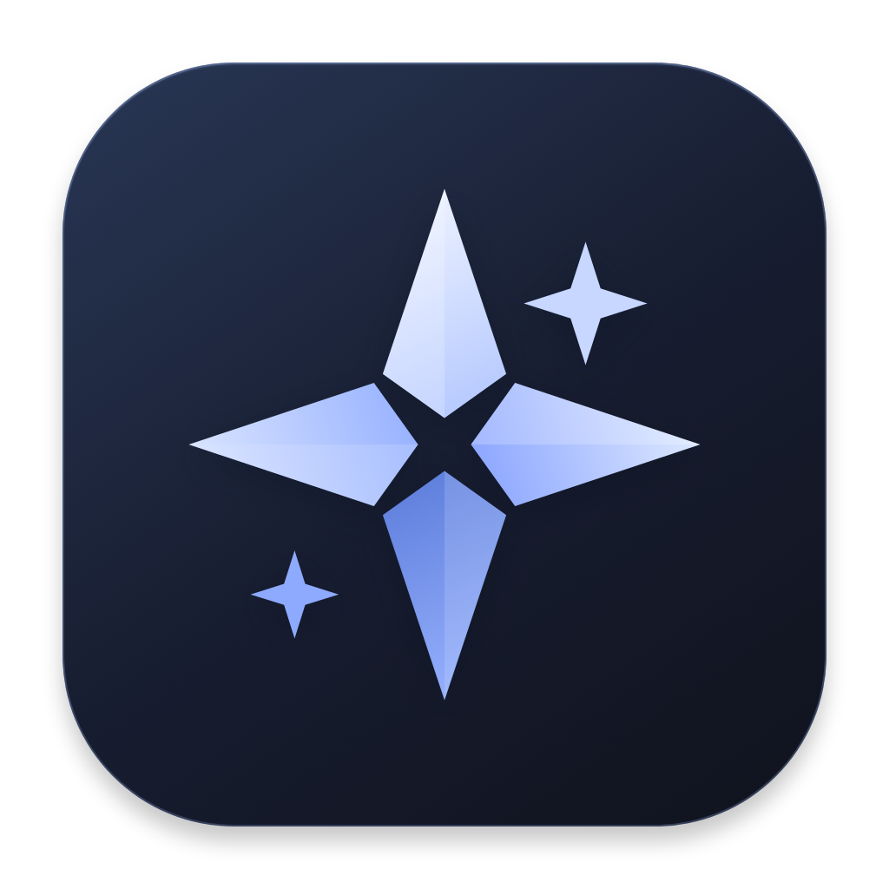

<p align="center">
  
</p>

<h1 align="center">NexusIDE</h1>

<p align="center"><strong>Your agents. Your models. One workspace.</strong></p>

Build a team of specialized AI agents for coding and research—with shared project memory, reviewable actions, and one runtime across your terminal, desktop, and editor.

[Visual user guide](docs/user-guide.md) · [Quick start](#start) · [Architecture](#architecture) · [Project status](#project-status)

> **Development preview:** a working local prototype, not a production-certified release. Agent portability and model support depend on the available adapters; see [compatibility and implementation boundaries](docs/architecture.md).

[](docs/user-guide.md)

*The actual NexusIDE dashboard, using synthetic demonstration data. Start with a task, follow the work, and review requested actions. The macOS app uses the same interface.*

## Why NexusIDE?

- **Build a team with clear roles.** Give each agent instructions, skills, tool permissions, and a focused memory loadout.
- **Choose models by role.** Route agents to configured local or cloud profiles through Anthropic and compatible Chat Completions adapters. [See tested providers.](docs/providers.md)
- **Keep control of the work.** Review plans, approve sensitive agent actions, and inspect changes in optional Git worktrees before merging.
- **Keep useful project context.** Reuse scoped, versioned memory and search incrementally indexed code and documents across tasks.
- **Use your preferred interface.** Work through the CLI, local dashboard, macOS window, VS Code terminal launcher, or Zed ACP bridge.

Start with a development team—architect → coder → reviewer—or assemble research, trading-research, and movie-planning workflows using the optional packs and explicitly configured integrations. External tools and model services require their own setup.

Optional additions include [Cortex knowledge retrieval](docs/cortex.md),
[independent plan and implementation reviews](docs/independent-review.md),
the [Code map](docs/code-map.md), and [Anatomy technical illustrations](docs/anatomy.md).
Use `nexus extras install review` or `nexus extras install anatomy` in an initialized
workspace. Cortex setup needs explicit engine and brain paths. The Code map uses
the existing optional codebase-memory-mcp connection. These are opt-in additions
to the 28 default agents; private knowledge and external engines are not bundled.

New native adaptations include [safe workflow checkpoints](docs/workflow-checkpoints.md),
[local-model memory guidance](docs/local-model-fit.md), and an
[RRSI-inspired offline improvement check](docs/rrsi.md). The runtime also stops
exact repeated tool failures early. These do not require another agent runtime.

## Architecture

One shared runtime connects your interfaces, agents, models, approved tools, and local project state. This is the same system map shown in **About** inside the app.

[](ui/illustrations/architecture.svg)

*Select the diagram for a full-size view. Local-first does not mean always offline: configured cloud providers and external tools receive the context you send. See the [implementation map](docs/architecture.md) for exact capabilities and limits.*

## Project status

NexusIDE includes a working agent runtime, SQLite-backed history and retrieval, editor adapters, and a self-contained **macOS development app**. The app is ad-hoc signed, not Developer ID signed or notarized. Windows and Linux desktop builds remain future work.

The latest [integration and connection audit](docs/audit-2026-10-24.md), earlier [workflow audit](docs/audit-2026-10-08.md), [provider matrix](docs/providers.md), and [security boundaries](SECURITY.md) document what has been checked and what remains unverified. Release preparation includes [signing/notarization tooling](docs/macos-release.md), an [isolated install/recovery rehearsal](docs/release-testing.md), and [internal security review](docs/security-review-2026-10-09.md). Apple enrollment, genuine clean-device acceptance, and a [consented production pilot](docs/production-pilot.md) remain release gates; automated passes are not production certification.

Explore the [illustrated user guide](docs/user-guide.md) for task planning, agent configuration, memory, approvals, and the Research Harness connection—or try the offline walkthrough below.

## Start

Requires Node.js 22.18+ and npm. Git is needed for worktrees. The PTY dependency may need platform build tools when a prebuilt binary is unavailable.

```sh
npm install
npm start -- init
npm start -- packs install
npm start -- serve
```

Open the **complete URL printed by the server**, including its login fragment. The dashboard binds to `127.0.0.1`; each launch creates a new access token. It supports tasks, teams, approvals, project file editing, agent configuration, memory, skills, run history, and provider settings.

Try without credentials:

```sh
npm start -- run architect "Inspect this project" --demo
npm start -- team run movie-studio "Plan a two-minute science-fiction short" --demo
npm start -- doctor
```

The offline demo is scripted and exercises orchestration and file tools. It does not generate AI answers. Disable “Offline demo” in the dashboard after configuring a provider.

Run `npm link` if you want a `nexus` command available from other project directories. Each directory has its own `.nexus` configuration, agents, notes and history. Add `.nexus/` to that project's `.gitignore`.

## Models and connections

Configure using shell environment variables:

```sh
export NEXUS_PROVIDER=anthropic
export NEXUS_MODEL='YOUR_MODEL_ID'
export ANTHROPIC_API_KEY='YOUR_API_KEY'
npm start -- run architect "Inspect the project and propose a plan"
```

For a compatible Chat Completions service, set `NEXUS_PROVIDER=compatible`, `NEXUS_MODEL`, `NEXUS_API_KEY`, and `NEXUS_BASE_URL` (defaults to `https://api.openai.com/v1`). Local Ollama typically uses `http://localhost:11434/v1`; select an installed tool-capable model and unset unrelated key variables. On Windows, persist cloud keys with PowerShell's `[Environment]::SetEnvironmentVariable("OPENAI_API_KEY", "your-key", "User")`, then reopen PowerShell before starting Nexus. NexusIDE does not automatically read `.env` files. The CLI and browser dashboard run on Windows; the packaged native desktop app is currently macOS-only.

For different models by role, edit [the example configuration](integrations/providers.example.json), then import your file:

```sh
nexus config import my-connections.json
nexus run architect "Plan this change" --provider claude
```

Provider profiles reference `keyEnv` or `keySecret`, never plaintext API keys. Routes map agent names to profiles, with an optional default route. If configured, input/output prices per million tokens produce **estimates**, not provider billing totals. Actual model identifiers, credentials, pricing and service compatibility belong to your provider.

Run `nexus providers` to inspect saved compatibility evidence, or `nexus providers check NAME` for a bounded synthetic check of a configured profile (remote requests may incur charges). Profiles support output-token caps and timeouts. Selected Ollama and OpenAI models have passed live checks; Anthropic and Gemini are not yet live-validated. See [provider compatibility](docs/providers.md) for exact models, results, options and limits.

Optional advanced integrations include a restricted REA reverse-engineering MCP connection, a read/query Hyper-Extract MCP connection, and the CLI-Anything discovery skill. This workspace has all three configured. REA is assigned only to `reverse-engineer`, Hyper-Extract to `literature-researcher`, and CLI-Anything to the non-executing `cli-adapter-planner`. See [the advanced configuration template](integrations/advanced.example.json) and [integration review](docs/integrations.md).

MCP connections support stdio and streamable HTTP. A server is contacted only if assigned in the agent's `mcp` list and approved by you. Its configured `tools` array is an explicit allowlist; an empty list exposes no tools. Every tool call requires approval, regardless of server annotations. See [integration review](docs/integrations.md).

## Agents and skills

`init` adds architect, coder, reviewer, researcher, tester and security-reviewer roles without overwriting existing definitions. `packs install` adds research, trading-research and movie-studio teams. Edit agents through the dashboard or `.nexus/agents/*.json`.

```sh
nexus install examples/scientific-reviewer.json
nexus import /path/to/foreign-agent.md
nexus skills scan /path/to/skill-directory
nexus skills import /path/to/skill-directory
nexus skills list
nexus skills audit
nexus inspect scientific-reviewer
```

Native JSON agents have explicit permissions. Foreign Markdown agent imports preserve instructions and record compatibility/provenance, with read-only permissions initially. Skill imports preserve SKILL.md and supporting resources, reject links, hash the package, and never run scripts or installers. `nexus skills scan` reports static indicators and coverage before import; `nexus skills audit [name]` checks stored integrity and rescans installed packages. The dashboard also offers an Audit skill button. Neither a clean scan nor a matching digest certifies safety or publisher identity. Assign imported names in an agent's `skills` array. A skill's `allowed-tools` field grants no permissions.

Selected Agency Agents and scientific/security/diagram/writing skills are already imported in this workspace; [the integration review](docs/integrations.md) records their source commits and limitations. Use `writing-editor` to opt into the imported writing skill. Imports stored in `.nexus` are local state, not bundled into the source distribution.

## Tools and terminal

```sh
nexus install examples/terminal-coder.json
nexus run terminal-coder "Inspect the code and run relevant checks" --allow-commands
nexus terminal
```

Agent commands require `permissions.execute: true`, the run option, and action approval. The command executor uses executable/argument arrays, a 60-second timeout, 100 KB combined output cap, and cancellation. It does not interpolate shell strings. An explicitly approved shell or interpreter can still execute arbitrary code.

`nexus terminal` is a user-operated PTY shell. The authenticated dashboard and packaged macOS app also expose an explicitly started local shell under **Terminal**. Commands run directly under your account; this is not an agent sandbox and output is not silently fed to a model.

For Docker execution, add `--sandbox-image repository@sha256:DIGEST` to an agent run. The image must already exist locally. Network is disabled, root filesystem is read-only, capabilities are dropped, and CPU, memory and process counts are bounded. The workspace is writable. Keep credentials and `.nexus` outside a sandbox workspace by using a separate worktree. Docker is required; there is no fallback to host execution when Docker fails.

## Worktrees and teams

From a Git repository root with a committed HEAD:

```sh
nexus worktree create my-task
nexus run coder "Implement the requested change" --worktree my-task
nexus worktree diff my-task
nexus worktree list
nexus team run development "Implement the requested feature"
```

Worktrees start from committed HEAD; local uncommitted files are not copied. Agent definitions and logs stay in the original project. `nexus worktree diff` shows tracked edits and bounded previews of new text files; protected and binary files are omitted. Write-capable runs acquire a workspace lock. Read-only workflow stages may run concurrently; writes in a shared workspace serialize.

After reviewing and committing the intended worktree changes, use `nexus worktree merge NAME` for an explicitly approved fast-forward merge. Both workspaces must be clean; source/destination revisions are checked again after approval. Protected paths, links, binary changes, configured Git content filters and divergent histories require manual handling. The command retains the worktree and does not push.

Custom teams are JSON DAGs with `id`, `agent`, `task`, optional `dependsOn`, and optional `approval` on each step. Use `nexus team install team.json`. `--isolated` creates separate step worktrees; upstream **reports** are handed off, but changes are not automatically merged. Use shared sequential stages when later steps must work on earlier edits. Worktrees remain for review after success, failure or cancellation.

## Research and hobbies

- `research`: literature researcher → statistical reviewer → manuscript reviewer.
- `trading-research`: market researcher → strategy analyst → risk reviewer.
- `movie-studio`: story developer → production planner → film editor.

The teams work with supplied content and their assigned tools. [Hobby application profiles](integrations/hobbies.example.json) connect TradingAgents and OpenMontage. Install and configure their isolated managed runtimes with `nexus integration install tradingagents`, `nexus integration configure tradingagents`, and the equivalent `openmontage` commands. `nexus integration status` reports checked-out revisions and executable readiness. TradingAgents is limited to research CLI flags; OpenMontage is limited to preflight, named zero-key demos, Backlot, and its simulated run. Every launch still requires agent execution permission, `--allow-commands`, and explicit approval. No brokerage/order-placement API is built into NexusIDE.

## Memory, history and credentials

```sh
nexus memory add "Use Python for numerical analysis"
nexus memory add "Prefer concise reviews" --agent reviewer
nexus memory search "analysis"
nexus memory forget MEMORY_ID
nexus project index
nexus project semantic "where is accessibility handled?"
nexus status
nexus recover
nexus recover activity
nexus status RUN_ID
nexus run architect "Continue with this refinement" --resume RUN_ID
```

Memory has three layers—facts/decisions, summaries, and preferences—with project or agent ownership, revision history, expiry, and per-agent selections. `memory search` combines local keyword and optional semantic retrieval, with keyword fallback. `memory distill RUN_ID --provider PROFILE` explicitly proposes evidence-backed drafts after transmission approval; each candidate needs separate review. See [memory governance, commands, and limits](docs/memory.md). Continuations carry prior conversation prose into a new run; unfinished tool calls are not replayed. Default limits are 20 model steps and 160,000 serialized context characters.

Project retrieval is separate from agent memory. `nexus project index` scans supported source/document files, reuses embeddings for identical chunks (including renamed files), and removes deleted sources. Use `project index --mode lexical` for a local keyword index and `project search "query"` for hybrid search with keyword fallback. It excludes protected directories, links, binaries and files over 100 KB; each scan is bounded to 10,000 files, 50 MB and 30,000 chunks. The strict `project semantic` command requires embeddings and returns bounded excerpts after checking current file digests. Use `--force` to replace all embeddings, including after changing a model behind the same model name.

Run history, workflows, notes and semantic indexes use `.nexus/storage.sqlite`. Existing JSON history migrates transactionally on first access; original files are retained. Configuration, agent definitions, skills, locks, receipts and the encrypted vault remain in their existing locations. `nexus storage status`, `nexus storage migrate` and `nexus storage backup <file.sqlite>` expose migration, integrity and snapshot operations. See [storage and recovery](docs/storage.md) before upgrading an active workspace or restoring a backup.

If a crash leaves a workspace lock, `nexus recover` lists lock keys and whether the recorded process is present. `nexus recover <key-prefix>` asks for confirmation before removing a unique stale lock. Inspect the process and workspace before approving; run history and workspace changes remain available afterward.

New runs and workflows record their owning process and host. `nexus recover activity` lists unfinished records; `nexus recover run ID` or `nexus recover workflow ID` marks one as interrupted only after confirmation and a recheck that its process is absent on this host. Legacy records without ownership and records from another host are not changed. Recovery does not replay tools or remove writer locks.

For optional encrypted secrets, set `NEXUS_VAULT_PASSWORD` (at least 12 characters) and `NEXUS_SECRET_VALUE` in your shell, run `nexus secret set NAME`, then unset the value variable. Reference `keySecret: "NAME"` in a provider profile. The vault uses scrypt and AES-256-GCM; losing its password loses access. `nexus secret list` returns names only. Known credentials are redacted from new run logs, but redaction cannot identify every possible secret in source files or provider output.

## Editors

The [VS Code extension](extensions/vscode) launches the same CLI in an integrated terminal and requires workspace trust. Set its `nexuside.cliPath` user setting to this installation's absolute `src/cli.js` path. Activation, command registration, real CLI initialization, the Run Agent command and persisted demo history were verified inside VS Code 1.127.0 using an isolated test workspace. Dashboard launch still needs a manual user-flow check.

[Zed tasks](integrations/zed/tasks.json) launch the CLI/dashboard/terminal after `npm link`. Add these task entries to your project's existing `.zed/tasks.json`; preserve existing entries. NexusIDE also provides an Agent Client Protocol (ACP) bridge: configure the absolute Node and `src/cli.js` paths from [the Zed agent settings example](integrations/zed/agent-settings.json). The bridge exposes project agents as selectable modes and uses the shared runtime and approvals. The saved Zed 1.23.2 host check completed an interactive demo prompt with persisted history; automated tests cover protocol exchange and cancellation. Editor-provided MCP servers and extra-directory grants are deliberately not accepted; configure approved NexusIDE MCP access in the project.

## Verify and understand the boundaries

```sh
npm test
npm audit --omit=dev
npm start -- doctor
```

Tests exercise provider contracts, approvals, cancellation, file restrictions, import fidelity, memory scope, workspace locks, real local MCP protocol exchange, HTTP authentication/origin checks, vault encryption, and workflow scheduling. The automated suite uses synthetic fixtures and loopback model servers; it makes no paid model API calls. Separate opt-in live results are recorded in the [provider matrix](docs/providers.md). [Security boundaries](SECURITY.md) and [architecture status](docs/architecture.md) identify what remains unverified.

### Code graph navigator

The local build includes `codebase-navigator`, backed by the reviewed codebase-memory-mcp v0.11.0 release. It can search symbols and trace callers through approved read-only MCP calls, then verify claims against source. See [setup, scope and index refresh](docs/codegraph.md).

### Native macOS shell

Run `npm run desktop:build`, then `npm run desktop` to open the dashboard in a native window. It uses the same runtime and approvals. See [desktop setup and current limits](docs/desktop.md).

Run `npm run desktop:package` to create a self-contained, ad-hoc signed `NexusIDE.app` and architecture-specific compressed DMG. It bundles Node and production dependencies and opens from Finder with a project picker. `npm run desktop:verify-bundle` tests a relocated copy with a minimal PATH, an offline agent, SQLite and the embedded PTY. See [distribution details](docs/desktop-distribution.md).

Node/npm and this source checkout are not needed to launch the bundled app. Existing project state stays in `.nexus`; first launch creates only missing defaults. External tools/models remain separate. Public distribution still requires Developer ID signing/notarization and clean-machine testing.

Managed TradingAgents/OpenMontage installations now support staged upgrades, verified rollback, interrupted-setup recovery and recoverable disablement without moving existing virtual environments. Use `nexus integration status` and see [integration lifecycle](docs/integration-lifecycle.md) for commands, grants and remaining dependency boundaries.

## Acknowledgments

NexusIDE's later governed-memory design was informed by ideas presented in [TencentDB Agent Memory](https://github.com/TencentCloud/TencentDB-Agent-Memory), particularly layered memory, role-specific memory loadouts, and human-governed reusable context. NexusIDE implements its own local SQLite, full-text, and optional embedding-based system; it does not include or require TencentDB Agent Memory or a Tencent service. See [memory design and boundaries](docs/memory.md).
