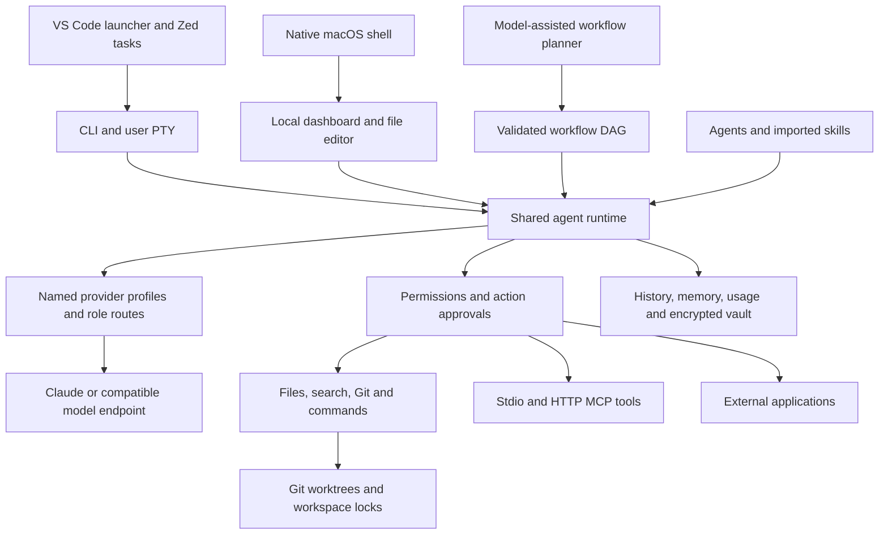

# NexusIDE implementation map

The supplied architecture diagram remains the product target. This document distinguishes implemented core features, adapters, and external prerequisites.

## Current build phase

NexusIDE is a working local prototype with a shared runtime, editor adapters and a macOS shell. Local model tool use, a small real-model coding workflow, selected editor-host demos, research evidence retrieval and a zero-key media render have verification evidence. These are bounded checks, not production certification. Standalone distribution, cloud-provider validation and broader real-world workloads remain open. See the [workflow audit](audit-2026-10-08.md) and [evaluation](evaluation.md) for scope and evidence.

The user-facing setup steps are in the [User Guide](user-guide.md). The concrete adaptation decisions for the supplied repositories are in [Integration review](integrations.md) and [the machine-readable catalog](../integrations/catalog.json).

## Status by diagram layer

| Layer | Working implementation | Boundaries |
|---|---|---|
| Interfaces | CLI; user PTY; packaged macOS WebKit host; authenticated local dashboard with task activity, approvals, agent editor, project file editor and embedded PTY; ACP bridge with selectable agents/modes and cancellation | Chrome desktop, 390 px mobile, 768 px tablet and plan-to-run checks passed. Saved VS Code and Zed host checks completed demo prompts with persisted history. Native discard/close protection and terminal output were visually rechecked during the audit. The app/DMG is an ad-hoc signed host that still needs the CLI and Node; Finder launch, Developer ID signing and notarization remain release work. |
| Agent runtime | Persistent definitions, explicit read/write/execute permissions, native JSON and foreign Markdown imports, skill resources and provenance, scoped memory | Imported vendor hooks and runtime-specific behavior are not emulated. |
| Orchestration | Model-assisted plan creation, role routing, sequential/parallel DAG stages, approval gates, structured report handoffs, bounded context, cancellation | Planner output must validate. Isolated stage worktrees exchange reports, not automatically merged files. No autonomous recursive delegation. |
| Tools and execution | File tools, bounded code search, protected Git diff/status, approved commands, user PTY, Docker command adapter, MCP transports, application profiles | Docker boundaries verified with a pinned local image in a synthetic workspace. Browser/database/codegraph capabilities depend on explicitly connected MCP services. |
| Model routing | Claude Messages, compatible Chat Completions, offline demo; named profiles by role; per-run override | No claim of universal compatibility. Each provider/model combination needs a live check. Routing uses user rules, not an unvalidated quality predictor. |
| Persistent state | SQLite WAL transactions for runs, workflows, notes and incremental semantic indexes; bounded history summaries and vector scans; JSON configuration/definitions/locks; encrypted vault; explicit interrupted-run recovery | One-time history migration retains legacy JSON; consistent database snapshots and integrity checks are available. Retrieval remains an exact vector scan with bounded top results, not an approximate-nearest-neighbor service. No replay of unfinished actions. See [storage](storage.md). |
| Workspace | Git worktree creation/list/diff, approved fast-forward merge, explicit branch names, per-workspace writer locks | Requires an existing committed repository. No automatic merge, branch deletion or dirty-worktree cleanup. |

## Integration progress

This workspace has development agents, research/trading/movie packs, selected imported Agency Agents and seven imported skills. Advanced connections include Research Harness, code graph, REA and Hyper-Extract; definitions and grants remain private local `.nexus` state, not bundled source. CLI-Anything is imported as an instruction skill for the non-executing planner. A bounded static scanner records skill findings; scan results and hashes are not a safety certificate.

Research Harness first passed a connection/read check, then a real-abstract evidence retrieval and local-model summary check. See `.nexus/verification/research-harness.json` and `research-evidence.json`. This does not validate an entire research study or its conclusions.

Other projects have compatibility assessments in [integrations.md](integrations.md). TradingAgents and OpenMontage have installed isolated runtimes, restricted launchers and explicit grants. Historical checks cover local-model market research with a structured-output failure requiring manual review, and a zero-key OpenMontage demo render. Cloud generation and reliable structured trading ratings are not validated. Managed installers now pin reviewed revisions, check origin/HEAD and preserve existing environments.

## Validation

The Node tests use temporary directories and repositories, a real local MCP subprocess, an HTTP MCP fixture, a mocked model endpoint, and the actual dashboard API. A PTY process was launched successfully on macOS. No cloud model API calls have been made. The installed Ollama `gpt-oss:20b` model called `list_files` and `read_file` through the actual runtime and returned the synthetic fixture content; receipt: `.nexus/verification/local-model.json`. Chrome visual checks covered dashboard navigation, file draft protection and discard, an offline task, run history, approval decline, and cancellation; receipt: `.nexus/verification/dashboard-visual.json`.

After Ollama was reinstalled, `gpt-oss:20b` again completed the live synthetic tool-use check and `nomic-embed-text` passed semantic ranking and agent-scope checks on 2026-10-08. Docker live checks passed using an existing pinned PostgreSQL Alpine image: workspace reads/writes, read-only root, zero effective capabilities, no-new-privileges, no active external network or routes, and an outside file not mounted. Receipt: `.nexus/verification/docker.json`. These checks cover these boundaries, not every container attack. Security controls and residual risks are documented in [SECURITY.md](../SECURITY.md).

## Remaining work toward the full product

1. Validate selected cloud models and manually check the VS Code dashboard-launch flow. VS Code's Run Agent command and Zed's ACP bridge have completed real host-level demo prompts with persisted history.
2. Extend live provider and container checks to real development tasks and additional supported models.
3. Validate browser services and connect real research projects. Semantic note retrieval and codebase-memory-mcp now have live synthetic checks; extend their scope beyond notes and source-only indexing.
4. Expand TradingAgents/OpenMontage beyond their existing smoke workflows after provider/data/media choices, cost limits and successful structured-output checks.
5. Benchmark larger real projects and consider approximate-nearest-neighbor retrieval if exact scans become too slow. SQLite storage and incremental note/code/document indexing complete the first storage phase; see [release phases](release-phases.md). Richer terminal emulation and standalone macOS distribution remain. Stale writer locks can be inspected and cleared with `nexus recover` after the owning process is confirmed absent.

These remaining items are not represented as completed features.
