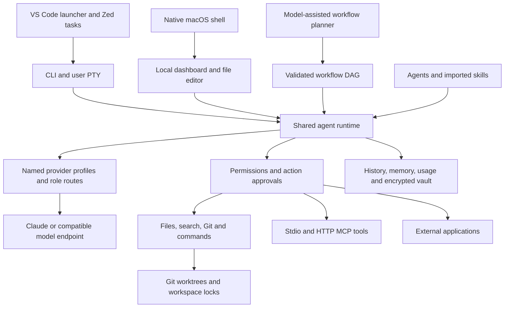

# NexusIDE implementation map

The supplied architecture diagram remains the product target. This document distinguishes implemented core features, adapters, and external prerequisites.

## Current build phase

NexusIDE is in **Phase 1: terminal-first runtime and safety hardening**. The core local prototype is implemented. Current work is making imports reviewable, documenting actual workflows, and choosing a small number of integrations that add capabilities without turning the core into a bundle of unrelated runtimes. Phase 1 is not complete: editor-host verification and end-to-end research/media workflows remain open; local model tool use and Docker boundaries have passed live synthetic checks. Phase 2 is editor integration and selected optional services; a source-built macOS shell now wraps the dashboard; standalone distribution and mobile interfaces remain later work. See [the latest evaluation](evaluation.md) for verification results and resumption notes.

The user-facing setup steps are in the [User Guide](user-guide.md). The concrete adaptation decisions for the supplied repositories are in [Integration review](integrations.md) and [the machine-readable catalog](../integrations/catalog.json).

## Status by diagram layer

| Layer | Working implementation | Boundaries |
|---|---|---|
| Interfaces | CLI; user PTY; packaged macOS WebKit app; authenticated local dashboard with task activity, approvals, agent editor, project file editor and embedded PTY; ACP bridge with selectable agents/modes and cancellation | The browser dashboard passed desktop, 390 px mobile, 768 px tablet and task-planning checks in Chrome. VS Code activation and terminal initialization passed a real host check; interactive agent selection is pending. Zed 1.23.2 launched the custom ACP process and completed a persisted demo prompt. The macOS app passed native visual workspace/navigation and embedded-terminal checks plus reproducible app/DMG packaging with ad-hoc signing; Developer ID signing and notarization remain pending. |
| Agent runtime | Persistent definitions, explicit read/write/execute permissions, native JSON and foreign Markdown imports, skill resources and provenance, scoped memory | Imported vendor hooks and runtime-specific behavior are not emulated. |
| Orchestration | Model-assisted plan creation, role routing, sequential/parallel DAG stages, approval gates, structured report handoffs, bounded context, cancellation | Planner output must validate. Isolated stage worktrees exchange reports, not automatically merged files. No autonomous recursive delegation. |
| Tools and execution | File tools, bounded code search, protected Git diff/status, approved commands, user PTY, Docker command adapter, MCP transports, application profiles | Docker boundaries verified with a pinned local image in a synthetic workspace. Browser/database/codegraph capabilities depend on explicitly connected MCP services. |
| Model routing | Claude Messages, compatible Chat Completions, offline demo; named profiles by role; per-run override | No claim of universal compatibility. Each provider/model combination needs a live check. Routing uses user rules, not an unvalidated quality predictor. |
| Persistent state | Atomic JSON records, transcripts/events, continuation context, project/agent notes, lexical recall, bounded hybrid semantic project indexing, usage and configured cost estimates, encrypted vault, explicit interrupted-run recovery | Local Ollama semantic note and code/document indexing are implemented with protected-path, file-count, byte and storage limits. Larger database backends remain pending. No crash replay of unfinished actions. |
| Workspace | Git worktree creation/list/diff, approved fast-forward merge, explicit branch names, per-workspace writer locks | Requires an existing committed repository. No automatic merge, branch deletion or dirty-worktree cleanup. |

## Integration progress

This workspace has the default development agents (including a read-only UI reviewer), research/trading/movie packs, five imported Agency Agents, six imported skills, and a `harness-researcher` connected to an empty Research Harness test project. The `no-ai-slop` skill is assigned to the optional `writing-editor` agent only. A native ACP bridge shares the same runtime with editor clients and exposes configured agents as session modes. A bounded static skill scanner now records findings during skill import and is available as a pre-import CLI check.

Research Harness was installed in a project-local Python environment and its four granted evidence readers were discovered through the real MCP connection; `list_sources` returned the expected empty result. Its receipt is in `.nexus/verification/research-harness.json`. This proves the local connection and tool call, not a completed research workflow.

Other requested projects have reviewed compatibility assessments and configuration paths in [integrations.md](integrations.md). TradingAgents and OpenMontage have named application profiles and hobby teams. Their full runtimes and model/media/data credentials are not yet configured here. VS Code activation/initialization and Docker isolation passed live synthetic checks. Zed verification remains outstanding.

## Validation

The Node tests use temporary directories and repositories, a real local MCP subprocess, an HTTP MCP fixture, a mocked model endpoint, and the actual dashboard API. A PTY process was launched successfully on macOS. No cloud model API calls have been made. The installed Ollama `gpt-oss:20b` model called `list_files` and `read_file` through the actual runtime and returned the synthetic fixture content; receipt: `.nexus/verification/local-model.json`. Chrome visual checks covered dashboard navigation, file draft protection and discard, an offline task, run history, approval decline, and cancellation; receipt: `.nexus/verification/dashboard-visual.json`.

After Ollama was reinstalled, `gpt-oss:20b` again completed the live synthetic tool-use check and `nomic-embed-text` passed semantic ranking and agent-scope checks on 2026-10-08. Docker live checks passed using an existing pinned PostgreSQL Alpine image: workspace reads/writes, read-only root, zero effective capabilities, no-new-privileges, no active external network or routes, and an outside file not mounted. Receipt: `.nexus/verification/docker.json`. These checks cover these boundaries, not every container attack. Security controls and residual risks are documented in [SECURITY.md](../SECURITY.md).

## Remaining work toward the full product

1. Validate selected cloud models and manually check the VS Code dashboard-launch flow. VS Code's Run Agent command and Zed's ACP bridge have completed real host-level demo prompts with persisted history.
2. Extend live provider and container checks to real development tasks and additional supported models.
3. Validate browser services and connect real research projects. Semantic note retrieval and codebase-memory-mcp now have live synthetic checks; extend their scope beyond notes and source-only indexing.
4. Complete separate TradingAgents/OpenMontage environments and end-to-end hobby workflows once their provider/data/media setup is selected.
5. Evaluate a larger vector/database backend and richer terminal emulation. Bounded local code/document retrieval, an authenticated embedded PTY, and macOS app/DMG packaging are implemented. Reviewed fast-forward merges and explicit run/workflow crash-status recovery are implemented and tested. Stale writer locks can be inspected and cleared with `nexus recover` after the owning process is confirmed absent.

These remaining items are not represented as completed features.
