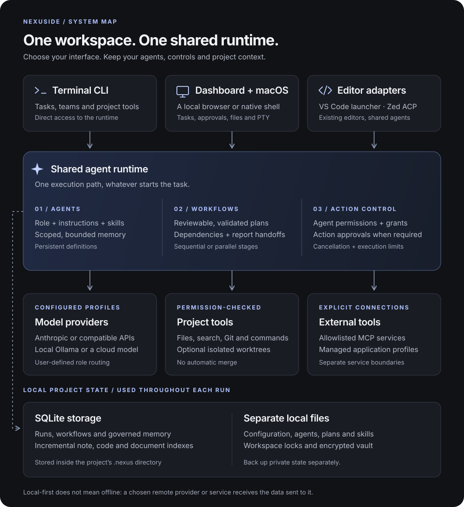
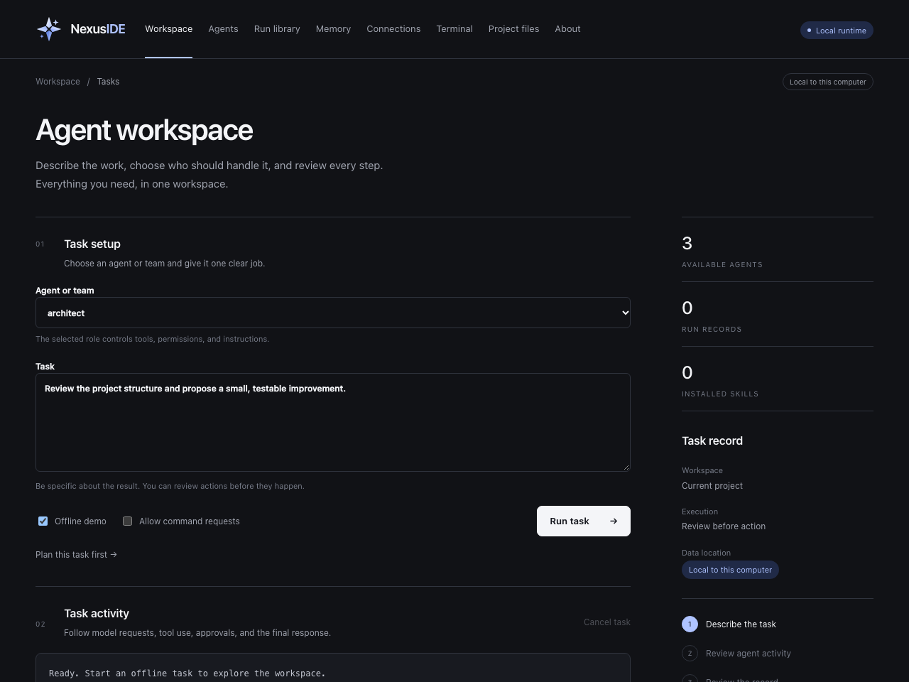
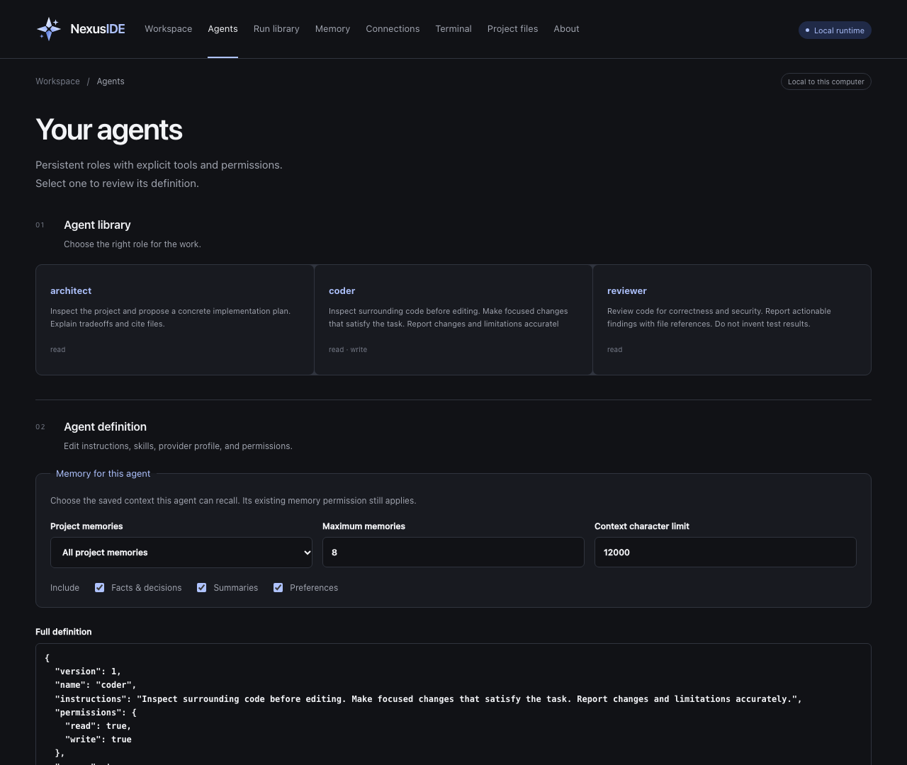
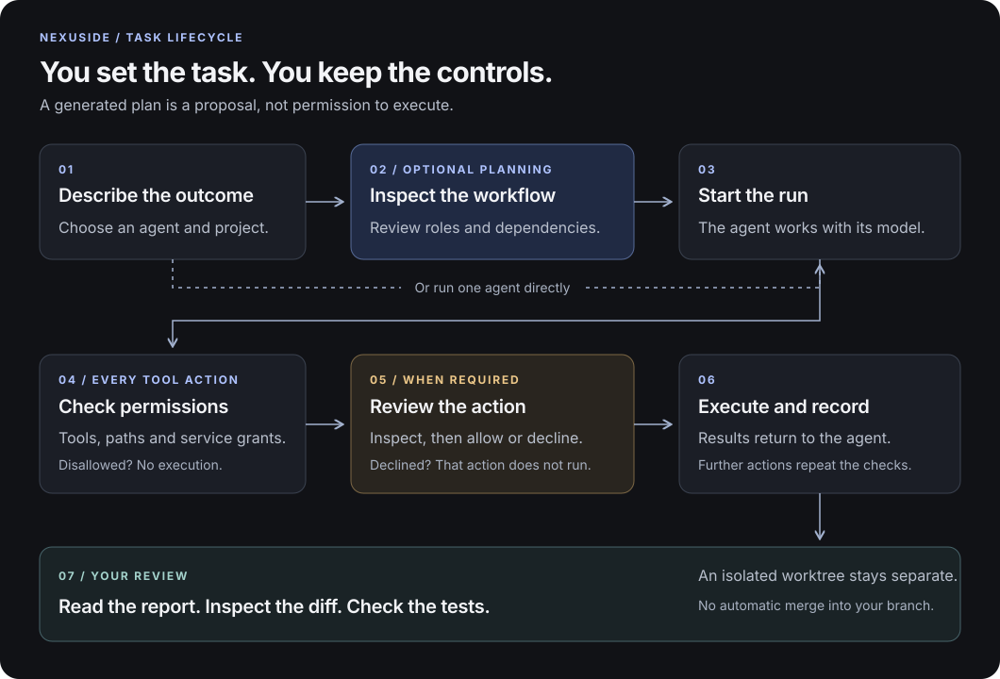
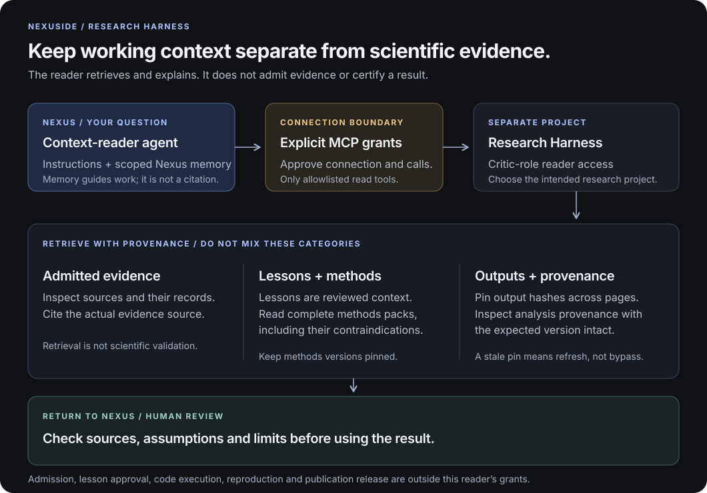
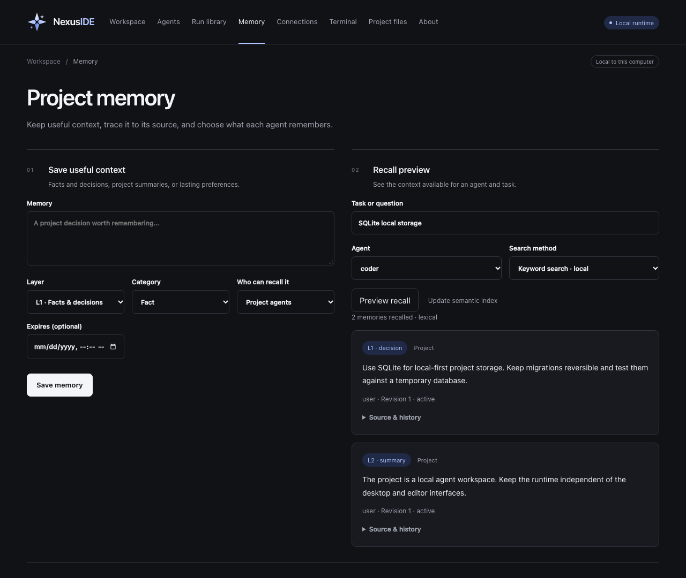
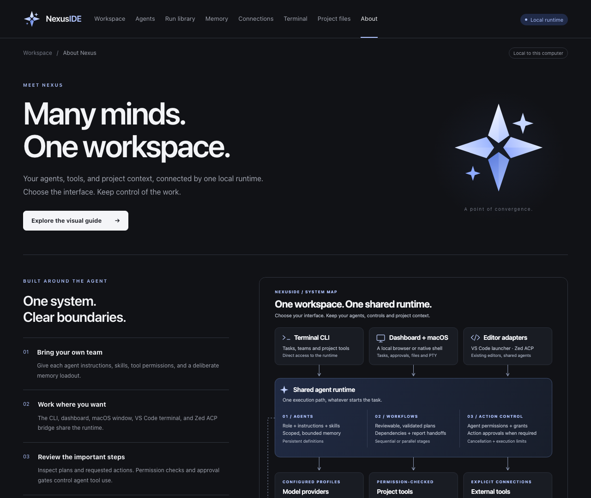
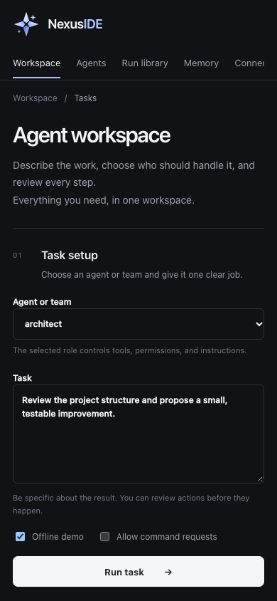

# NexusIDE User Guide

NexusIDE runs project agents from a terminal, local dashboard, VS Code terminal, or a Zed ACP connection. Agents use the same project configuration, tool approvals, memory, and run history in each interface.

## A visual tour

**Connect a cloud model:** Export your provider's API key before starting Nexus, then open **Connections → Choose your model**. Pick a provider and account, scroll through that account's models, choose the workspace default or a particular agent, and click **Use this model**. OpenAI, Anthropic, Gemini, xAI, DeepSeek, Kimi, GLM, and Qwen have built-in presets. Missing keys and example values are clearly marked. Numbered exports such as `OPENAI_API_KEY2` add separate account choices. See [provider setup](providers.md#choose-a-provider-in-the-dashboard) for environment variables, regional accounts, and macOS launch behavior.

Start with [your first task](#2-open-the-dashboard), then learn to [configure an agent](#4-run-an-agent), [review a plan](#5-run-teams-and-review-isolated-changes), [connect research tools](#7-use-research-and-hobby-workflows), and [control memory](#9-save-and-inspect-memory).

The screenshots below show the actual dashboard in an isolated demonstration project. Names, tasks, and notes are examples, not your private workspace. They illustrate the interface, not a live model connection, a completed research study, or release certification. Open any image to inspect it at full size.

In the app, open **About → Explore the visual guide** for the bundled visual walkthrough. In the macOS window, use **View → Back** (Command-[) after opening a full-size diagram or the Markdown reference; use **View → Forward** (Command-]) to return.



*One runtime, several interfaces. The same architecture diagram appears in the app's About page. Local storage does not mean every action stays offline: configured cloud models and external tools can transmit data. See [architecture status](architecture.md) for implemented capabilities and limits.*

## 1. Install and initialize a project

Use Node.js 22.18 or newer and Git. From the NexusIDE source directory:

```sh
npm install
npm start -- init
npm start -- packs install
npm start -- doctor
```

`init` creates `.nexus/` with the bundled public agent library (currently 28 definitions, including the core, research, software, review, media, and harness roles) and a development workflow. `packs install` adds research and hobby workflows without replacing existing files. Some bundled roles use optional MCP or integration capabilities; configure those before running them. Add `.nexus/` to the project's `.gitignore` because it contains local history and configuration.

For another project, run `npm link` once from the NexusIDE source directory, change to the intended project, and use `nexus init`, `nexus packs install`, and `nexus serve`. The `npm start -- ...` examples in this guide assume you are in the NexusIDE source directory.

Start with the offline walkthrough:

```sh
npm start -- run architect "Inspect this project and summarize its structure" --demo
npm start -- team run movie-studio "Plan a two-minute science-fiction short" --demo
```

Demo responses are scripted examples. They do not call an AI model or make project changes.

## 2. Open the dashboard

```sh
npm start -- serve
```

Open the full local URL printed in the terminal, including its login fragment. The dashboard is bound to `127.0.0.1`. Use it to review agents, runs, approvals, files, skills, memory, and provider settings. Stop the server with Ctrl+C.



*Workspace · Define the outcome at the top, follow activity below, and inspect approval requests before allowing actions.*

For your first visual walkthrough:

1. Open **Workspace**, choose **architect**, and enter “Inspect this project and summarize its structure.”
2. Keep **Offline demo** checked and **Allow command requests** unchecked. Choose **Run task**.
3. Read **Task activity**, then open **Run library** and select the run to inspect its transcript. The demo is scripted; it has not inspected or changed your project.
4. After configuring a model, return to Workspace and uncheck **Offline demo** for a real task. Check the selected agent's permissions first.

An action requiring approval appears under activity with **Approve** and **Decline**. Read the exact paths, command, or MCP request; decline anything outside your intended task. **Cancel task** stops an active run but does not undo actions that have already completed.

## 3. Connect a model

For the dashboard, export a real key such as `OPENAI_API_KEY`, then launch Nexus from the same terminal and choose **Connections → Provider / account → Model → Use this model**. The standard key is Account 1. A second export named `OPENAI_API_KEY2` adds Account 2; the same numbering works for all eight provider variables through `99`. You can use Account 2 without setting Account 1, and route different agents to different accounts. Each model list belongs to its selected account. Nexus does not switch accounts automatically after an error or quota limit. See [all eight numbered-key examples](providers.md#multiple-accounts-with-numbered-keys).

For an installed macOS app, fully quit Nexus, then run `/Applications/NexusIDE.app/Contents/MacOS/NexusIDE` from the terminal containing those exports. Finder does not inherit them. Relaunch after changing exports; refreshing the picker cannot import changes made to another process's environment.

### Windows setup

The CLI and browser dashboard run on Windows with Node.js 22.18 or newer. In PowerShell, persist provider keys for your Windows user account with the following commands, replacing the example values with real keys:

```powershell
[Environment]::SetEnvironmentVariable("OPENAI_API_KEY", "your-openai-key", "User")
[Environment]::SetEnvironmentVariable("ANTHROPIC_API_KEY", "your-anthropic-key", "User")
[Environment]::SetEnvironmentVariable("GEMINI_API_KEY", "your-gemini-key", "User")
[Environment]::SetEnvironmentVariable("XAI_API_KEY", "your-xai-key", "User")
[Environment]::SetEnvironmentVariable("DEEPSEEK_API_KEY", "your-deepseek-key", "User")
[Environment]::SetEnvironmentVariable("MOONSHOT_API_KEY", "your-kimi-key", "User")
[Environment]::SetEnvironmentVariable("ZHIPUAI_API_KEY", "your-glm-key", "User")
[Environment]::SetEnvironmentVariable("DASHSCOPE_API_KEY", "your-qwen-key", "User")
```

For a second account, append the account number, for example:

```powershell
[Environment]::SetEnvironmentVariable("OPENAI_API_KEY2", "your-second-openai-key", "User")
```

Close and reopen PowerShell (and restart Nexus) after changing persistent variables. Then install and start the browser dashboard from the repository directory:

```powershell
npm install
npm start
```

The native packaged desktop application is currently macOS-only. On Windows, use the CLI or browser dashboard. Ollama can be used locally on Windows as an OpenAI-compatible service; start Ollama, pull a tool-capable model such as `gpt-oss:20b`, and configure its local endpoint under **Advanced connections & MCP** or with a compatible profile. Windows managed integrations and a native Windows installer remain future work.

For Anthropic, export a provider and API key in your shell:

```sh
export NEXUS_PROVIDER=anthropic
export NEXUS_MODEL='YOUR_MODEL_ID'
export ANTHROPIC_API_KEY='YOUR_API_KEY'
npm start -- run architect "Inspect this project and propose the next task"
```

The compatible Chat Completions option uses `NEXUS_PROVIDER=compatible`, `NEXUS_MODEL`, `NEXUS_API_KEY`, and optionally `NEXUS_BASE_URL`. For a local OpenAI-compatible service, set its local base URL and model identifier. NexusIDE does not read `.env` files automatically. See [provider profiles](../integrations/providers.example.json) for routing different agent roles to different providers.

This workspace now has a verified `local-ollama` profile using the already-installed `gpt-oss:20b` model. It is the default route here. With Ollama running, try `npm start -- run architect "Inspect the project structure"` without `--demo`. This configuration is local workspace state, so a fresh installation still needs its own provider setup.

Inspect saved compatibility evidence with `nexus providers`. To test your exact profile, run `nexus providers check NAME`; this sends only synthetic prompts and tool results, up to six requests, and may incur provider charges. It does not change your default route. Profiles can set `maxOutputTokens`, `timeoutMs`, and the compatible endpoint's `tokenLimitField`. See [provider compatibility](providers.md) for configuration, historical live results, credential isolation and untested targets.

## 4. Run an agent

```sh
npm start -- agents
npm start -- inspect architect
npm start -- run architect "Review the authentication design"
npm start -- status
```

Starter agent definitions are in `.nexus/agents/`. Each agent has instructions, permissions, and optional memory, skills, MCP servers, and applications. Edit the JSON through the dashboard or directly. Imported agents start read-only; agent instructions alone cannot grant tools.



*Agents · Give a role a bounded selection of useful context. Memory selection does not grant tools or enable an agent's memory permission.*

To tailor a role in the dashboard:

1. Open **Agents** and select the agent. Review its instructions and permissions in the definition editor.
2. Under **Memory for this agent**, choose all, selected, or no project memories. With **Selected memories**, use Command-click on Mac or Control-click on Windows to select multiple notes.
3. Choose the layers and context limits, then select **Save agent**. The agent's own eligible notes remain separate from the project-note selection; another agent's private notes are not available.

Memory must also be enabled with `"memory": true` in the definition. See [agent memory selections](memory.md#agent-memory-selections) for the exact limits and startup behavior.

To let an agent run approved commands, its configuration must enable execution and the run must also include the explicit flag:

```sh
npm start -- run tester "Run the unit tests and report failures" --allow-commands
```

Review each requested action when prompted. Host commands still run under your account. `nexus terminal` opens an interactive shell for you; that terminal is not a sandbox.

## 5. Run teams and review isolated changes

```sh
npm start -- team run development "Fix the failing parser tests"
npm start -- team status
npm start -- worktree list
npm start -- worktree diff TASK_NAME
```

Teams use dependency-ordered workflows. Use `--isolated` to give workflow steps separate Git worktrees; agents exchange reports, and their code changes are not automatically combined. Review each diff before bringing work into your branch. Worktrees require a Git repository with a committed starting revision.

To incorporate committed work, run `npm start -- worktree merge TASK_NAME`. NexusIDE shows the exact revisions, file list and diff for approval, then checks them again before fast-forwarding the current branch. It refuses dirty workspaces, divergent history, protected paths, links, binary changes and configured Git content filters. Commit the reviewed source changes yourself first; the merge command does not create commits, push, or delete worktrees.



*Plan before execution · A saved plan is a proposal, not completed work. Tool permissions and action approvals still apply when its team runs.*

`nexus plan "task description"` saves a reviewable workflow proposal and a corresponding `plan-…` team. It does not execute that team. The dashboard provides the same planning flow:

1. Enter a concrete task in **Workspace**, then select **Plan this task first →**. Keep **Offline demo** checked to explore with a scripted proposal, or uncheck it to use your configured planning model.
2. Inspect the proposal in **Task activity**: read each step's agent, task, dependencies, and approval requirement. Review each referenced agent's actual permissions too.
3. When satisfied, choose the newly saved `plan-…` team under **Agent or team** and select **Run task**. Planning and running are separate actions; a real run requires **Offline demo** to be unchecked.
4. Review tool requests during execution. Inspect the completed records and any changed files; use the CLI worktree commands above when running an isolated workflow.

Worktrees separate files, not host privileges. They are not a substitute for permission checks or a configured execution sandbox.

## 6. Import a third-party agent or skill

For Markdown agent instructions:

```sh
npm start -- import /path/to/agent.md
npm start -- agents
```

For a skill directory containing `SKILL.md`, scan it before importing:

```sh
npm start -- skills scan /path/to/skill-directory
npm start -- skills import /path/to/skill-directory
npm start -- skills list
npm start -- skills inspect SKILL_NAME
npm start -- skills audit SKILL_NAME
```

The scanner reports a small set of suspicious static patterns with file and line numbers. A clean scan is not a safety certification. Read the skill, supporting resources, source license, and provenance yourself. NexusIDE stores scripts but does not execute them during import. Assign a skill in an agent's `skills` list to make its instructions available to that agent. Tool names or `allowed-tools` text inside the skill do not grant runtime permissions.

Run `skills audit` without a name to check every installed package, or select **Audit skill** in the dashboard. Audits report skipped binary/non-UTF-8 resources and whether the findings cap left files unchecked. They do not modify imported packages. The runtime refuses packages whose resources no longer match the saved digest or whose cached instructions disagree with `SKILL.md`. This detects inconsistencies; a person who can modify local state can also replace its digest.

This workspace includes the optional `writing-editor` agent with the MIT-licensed `no-ai-slop` skill. Use it only when you want that editing approach:

```sh
npm start -- inspect writing-editor
npm start -- run writing-editor "Edit draft.md for clarity while preserving my voice"
```

It can read and propose edits to project files. Each file change still goes through NexusIDE's approval prompt. The skill and its evaluation file are preserved with commit and license provenance in `.nexus`.

## 7. Use research and hobby workflows

```sh
npm start -- team run research "Review the supplied paper and identify evidence gaps"
npm start -- team run trading-research "Compare these supplied strategy hypotheses"
npm start -- team run movie-studio "Create a production plan for a short film"
```

Research Harness and the included research skills support evidence-oriented work. Install a managed hobby runtime with `nexus integration install tradingagents` or `nexus integration install openmontage`, then connect it with `nexus integration configure NAME`. Check both with `nexus integration status`. External launches require `--allow-commands` and interactive approval. NexusIDE does not place trades; OpenMontage rendering remains subject to its own provider, media, cost, and licensing requirements.



*Research Harness remains a separate evidence system. Saved Nexus memories and Harness lessons can guide work, but are not citations or human attestations.*

For the optional updated Research Harness reader:

1. Review the [connection example](../integrations/research-harness.example.json) and [context-reader agent](../examples/harness-context-reader.json). Merge only the intended configuration into your project; set absolute paths for the Harness Python environment, Nexus's `integrations/research-harness-reader.py` bridge, and your research project. Install the agent with `nexus install examples/harness-context-reader.json` from the Nexus checkout.
2. Select `harness-context-reader` only after configuring it for the intended project. The existing local profile targets a demo project, not a real manuscript.
3. Approve the connection and each allowed MCP call after reading its request. Keep version/hash pins across paginated reads, and refresh stale data instead of removing a pin.
4. Check findings against their source evidence. Read complete methods guidance, including assumptions and contraindications; review provenance without treating an inspection as successful reproduction.

The updated reader supports Harness `0.16.0`: saved paper Q&A, reviewed study comparisons, causal worksheets, prompt experiment results and original-document citation checks. Try: “List saved workbench answers and explain their evidence and limitations.” The agent discovers records with `list_workbench_artifacts` and uses both `expected_version` and `expected_content_hash` for paged reads. Changed source/prompt references invalidate old pins; stale artifacts remain historical context. Citation offsets refer to extracted text, not PDF page numbers. Open original PDFs and create or approve work in the Harness workbench. Its saved AI accounts remain separate from Nexus's Connections settings.

The reader cannot admit evidence, approve lessons, run arbitrary research code, or release a publication. See [Research Harness integration details](integrations.md#tool-services) for the tested source version, grants, and synthetic verification command.

Managed runtimes support `upgrade`, `rollback`, `recover`, `unconfigure`, and `uninstall`. Upgrades stage the reviewed pin without moving existing environments; uninstall disables while retaining files. Configuration and lifecycle changes require confirmation. See [integration lifecycle](integration-lifecycle.md) before changing grants or recovering a failed installation.

## 8. Configure MCP tools

Review [the example provider and MCP configuration](../integrations/providers.example.json), then import a project-specific JSON file:

```sh
npm start -- config import my-connections.json
npm start -- config show
```

MCP servers run only when assigned to an agent and approved. Keep the tool allowlist narrow. Each tool call still requires approval. Never assume that a remote tool server's description enforces filesystem or network boundaries.

## 9. Save and inspect memory

```sh
npm start -- memory add "Use Python for this project's numerical analysis"
npm start -- memory add "Prefer concise reviews" --agent reviewer --layer L3
npm start -- memory search "Python"
npm start -- memory list --agent reviewer
npm start -- memory history MEMORY_ID
npm start -- memory update MEMORY_ID patch.json
npm start -- memory forget MEMORY_ID
```

Project and agent notes are local. They have L1 facts/decisions, L2 summaries, or L3 preferences, with revisions, expiry, and active/archived status. `memory search` defaults to hybrid retrieval with local keyword fallback; `--mode lexical` makes no embedding call. Agents with memory enabled can propose notes for approval. Their `memoryLoadout` chooses project notes, layers, and bounded context. See [memory management and selections](memory.md) for update-file examples, ownership, and limits.



*Memory · Save deliberately, preview what an agent can recall, and inspect a note's source before trusting it.*

The dashboard separates four decisions:

1. **Save useful context:** choose the layer, category, and project or agent scope. Record one useful fact, decision, summary, or preference; use expiry for temporary context.
2. **Preview recall:** select an agent and enter a task or question. **Keyword search · local** makes no embedding call. **Keywords + meaning** uses configured local embeddings when available; read the returned mode and warnings rather than assuming semantic retrieval occurred.
3. **Saved memories:** filter by agent, layer, or status. Edit inaccurate notes or archive context that no longer applies. Archived and expired notes remain inspectable but are excluded from recall.
4. **Proposed memories:** review each candidate against its evidence, then approve or reject it individually. A proposal is not recalled until approved.

To generate proposals in the UI, select a completed run in **Run library**, then choose **Extract memories**. This uses the current model route for the run's agent and requires approval before transmitting the excerpt; it may call a cloud provider. Review candidates back in **Memory**. For a fully offline extraction example, use the CLI `--demo` command below.

For semantic search, run `ollama pull nomic-embed-text` and add an `embeddings` field to your existing project configuration (preserve the other settings):

```json
"embeddings": { "model": "nomic-embed-text", "url": "http://127.0.0.1:11434/api/embed" }
```

Then run `npm start -- memory index` and `npm start -- memory semantic "your question"`. Add `--agent reviewer` to include that agent's notes. The dashboard provides update and search buttons. Indexing sends note text only to the configured local embedding endpoint. Update after adding or changing notes or switching models; unchanged text reuses its vectors. Changed/deleted notes are excluded from retrieval immediately. SQLite removes the previous 1,000-note/18-MB JSON ceiling; each vector has at most 8,192 dimensions and each index has a 512-MiB vector budget. Use `memory index --force` for a full embedding refresh. Code/document indexing uses the separate `project index` command.

Agents with memory enabled and embeddings configured can request hybrid retrieval through an approval prompt. Automatic startup context uses local keywords plus up to two recent selected summaries/preferences. Stored vectors, notes, revisions, and drafts are sensitive data in `.nexus/storage.sqlite`; legacy JSON copies may remain in `.nexus/indexes` and `.nexus/memory`. See [migration and backups](storage.md).

To distill a completed run, use `npm start -- memory distill RUN_ID --demo` offline, or `--provider PROFILE_NAME` for an explicit provider transmission approval. Review the evidence with `memory drafts`, then run `memory review DRAFT_ID CANDIDATE_ID approve --revision N` (or `reject`). Every candidate needs its own decision; L3 preferences must quote the original user. See [distillation boundaries](memory.md#reviewable-distillation).

## 10. Troubleshooting and security

```sh
npm start -- doctor
npm start -- status RUN_ID
npm start -- recover
npm start -- recover activity
```

`doctor` checks local setup. `status` shows run details. `recover` lists workspace locks; removing a stale lock requires a unique key prefix and interactive confirmation. Review [security boundaries](../SECURITY.md) before granting command, MCP, or application access. NexusIDE is a local prototype, not a hardened multi-user service.

For an unfinished run whose recorded process has exited, use `npm start -- recover run RUN_ID` (or `recover workflow WORKFLOW_ID`). After approval, its status becomes `interrupted` and its history is retained. Nothing is rerun. Continue deliberately with a new task or `run AGENT "Continuation task" --resume RUN_ID`. Records predating process ownership tracking remain unchanged; recover their stale locks separately if necessary.

## Current limits

The VS Code extension passed activation, terminal initialization and Run Agent checks inside VS Code 1.127.0 with persisted demo history. Zed 1.23.2 launched the NexusIDE ACP process and completed a demo prompt with persisted history. Docker is optional; its configured restrictions have now passed a live synthetic check on this machine. Selected Ollama and OpenAI models have passed synthetic text, tool-round-trip and structured-output checks. Other models, MCP servers, browser automation, trading runtime, and video tooling require separate setup and validation. See [architecture status](architecture.md), [provider compatibility](providers.md), and [integration review](integrations.md) for what has actually been exercised.

## Codebase navigation

The local `codebase-navigator` agent uses the installed codebase-memory-mcp backend to find functions and trace callers, then checks original source. It has read-only query grants. See [code graph setup and index refresh](codegraph.md) for its source-only scope, commands and verification.

For retrieval across code and documentation, run `nexus project index --mode lexical`, followed by `nexus project search "your question"`. With local embeddings configured, `project index` also builds vectors; `project semantic` requires them. The index excludes protected paths, links, binaries and oversized files, uses bounded storage, and filters changed or deleted source from results until the next rebuild.

## Health and verification history

Run `npm start -- doctor` to inspect configured connections, missing skill references, Docker availability and local verification receipts. `verificationHistory` records past checks, their timestamps and scope; it does not imply that today’s configuration was retested. The command makes no model API calls and starts no external MCP services.

## Desktop window

On macOS, run `npm run desktop:build` followed by `npm run desktop`. For another initialized project, use `nexus desktop` after linking the CLI. Closing the window cancels active jobs. See [desktop setup](desktop.md) for requirements, verification and distribution limits.

For Finder launch, build with `npm run desktop:package`, open `dist/NexusIDE.app`, and choose your project. Node and the core runtime are included. Existing `.nexus` state is kept, and missing defaults are initialized without model calls. Use **File → Open Project…** to switch projects. This remains an ad-hoc development build, not a notarized public release; see [distribution details](desktop-distribution.md).

## About and smaller screens



*About · A map of how the parts fit together, inside the workspace. This is the browser dashboard; it is not a native-window screenshot or evidence of macOS signing.*

Open **About** for the architecture overview. The diagram describes the shared runtime; optional integrations still require their own installation, configuration, grants, and validation.



*Narrow-screen layout · The same local dashboard adapts to smaller windows. Scroll the navigation row horizontally to reach additional sections.*

This is a responsive browser view, not a separate mobile application. The default server listens only on the computer's loopback address; a phone on the same Wi-Fi cannot reach it. Do not expose the development server to a network to reproduce this view—resize the browser on the host computer instead.
