# NexusIDE — Illustrated User Guide

**Version:** 0.2.0 development preview · **Checked against source:** 24 October 2026

NexusIDE is a project workspace for customized AI agents. You choose the agents,
models and tools; Nexus coordinates their work and records what happened. Use the
same project through a terminal, browser dashboard, native macOS window, or an
editor connection.

This is the complete Markdown reference. Its screenshots and SVG illustrations
are local files: GitHub can render them, and a local Markdown preview can display
them without an image service. Keep `docs/assets/guide/` and
`ui/illustrations/architecture.svg` with the document. The shorter in-app tour is
under **About → Explore the visual guide**.

> Start here: [install](#1-install-and-initialize-a-project) →
> [open the dashboard](#2-open-the-dashboard) → [connect a model](#3-connect-a-model)
> → [run an agent](#4-run-an-agent) → [review the result](#11-read-run-history-and-usage).

## Contents

| Get started | Work with agents | Operate your workspace |
| --- | --- | --- |
| [1. Installation and projects](#1-install-and-initialize-a-project) | [4. Agents and permissions](#4-run-an-agent) | [10. Troubleshooting](#10-troubleshooting-and-security) |
| [2. Dashboard and first task](#2-open-the-dashboard) | [5. Teams, plans and worktrees](#5-run-teams-and-review-isolated-changes) | [11. History and usage](#11-read-run-history-and-usage) |
| [3. Cloud accounts and Ollama](#3-connect-a-model) | [6. Agent and skill imports](#6-import-a-third-party-agent-or-skill) | [12. Files and terminal](#12-edit-files-and-use-the-terminal) |
| [Visual system map](#the-system-at-a-glance) | [7. Research and hobby integrations](#7-use-research-and-hobby-workflows) | [13. VS Code and Zed](#13-connect-vs-code-and-zed) |
| [Command conventions](#command-conventions) | [8. MCP connections](#8-configure-mcp-tools) | [14. Search and Code map](#14-search-projects-and-use-code-map) |
| [Platform choices](#11-choose-an-installation-path) | [9. Memory and recall](#9-save-and-inspect-memory) | [15. Backup and recovery](#15-back-up-restore-and-upgrade) |
| [Small-screen use](#22-use-a-smaller-window) | [16. Harness evaluation](#16-evaluate-harness-improvements-offline) | [17. Worked examples](#17-worked-examples) |
| [Current limits](#19-current-capabilities-and-limits) | [18. Command reference](#18-command-reference) | [20. Glossary and deeper guides](#20-glossary-and-deeper-guides) |

### The system at a glance


*Read from interfaces into the shared runtime, then into tools, models and local
state. Optional services require their own setup. Cloud providers and external
tools can receive the task context you send through them.*

### Command conventions

Most examples use `nexus`, running **inside the project you want to work on**.
Choose one way to make that command available:

| Installation | How to run an example |
| --- | --- |
| Source checkout, CLI linked | Run `npm link` once in the Nexus source folder, then use `nexus` in your project. |
| Source checkout, CLI not linked | In the Nexus source folder, replace `nexus COMMAND` with `npm start -- COMMAND`. That folder becomes the workspace. |
| Installed macOS app | Use the bundled Node/CLI paths in [section 1.4](#14-use-the-cli-bundled-with-the-macos-app); a global Node installation is unnecessary for that route. |

`/absolute/path/...`, `MODEL_ID`, `RUN_ID` and similar uppercase labels are
placeholders. Replace them with paths or IDs from your own installation.
Commands that contact a model can incur charges for that selected account.

Screenshots use synthetic projects and notes. A minimal screenshot fixture may
show three agents; a fresh current initialization supplies **28 default agent
definitions**. Optional definitions and existing customizations change that total.

## 1. Install and initialize a project

### 1.1 Choose an installation path

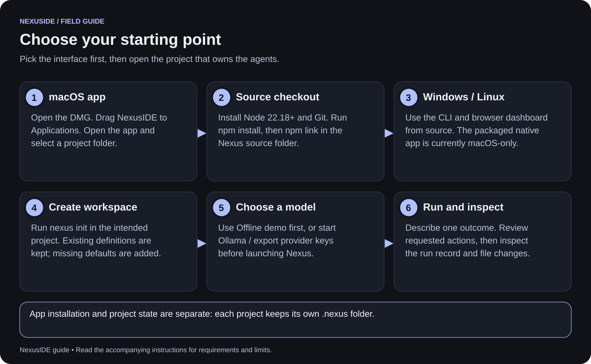

| Path | Included | Set up separately when needed |
| --- | --- | --- |
| macOS DMG | Native host, tested Node runtime, core JavaScript dependencies, dashboard, CLI, default definitions and public bundled resources. | Git, Ollama and model files, cloud keys, Python, Docker and optional integration runtimes. |
| Source checkout | Source, examples, guides and build/verification scripts. | Node.js 22.18+, npm, Git and dependencies installed with npm. |
| Windows/Linux source | CLI and local browser dashboard. | Platform prerequisites and chosen external tools. Native Windows/Linux installers are future work. |

The distributed macOS build is currently **ad-hoc signed**. Developer ID signing,
notarization and clean-machine acceptance remain release work. macOS 13 is the
declared deployment floor; the build is architecture-specific, not universal.
Use the artifact matching your machine. See [distribution details](desktop-distribution.md).

### 1.2 Install the macOS app

1. Open the NexusIDE DMG and drag **NexusIDE.app** into **Applications**.
2. Open the app and select the folder containing the project you want agents to
   inspect or change.
3. First launch creates missing default agents and the development team in that
   project's `.nexus` directory. Existing definitions and history are retained.
4. Use **File → Open Project…** to switch projects later.
5. Open **Connections** to select a model, or keep **Offline demo** on for the tour.

The development signature may be rejected by Gatekeeper. Do not disable
Gatekeeper globally; trusted distribution instructions belong in the
[macOS release guide](macos-release.md).

A new project does not inherit another project's `.nexus` automatically. Selecting
an existing configured project reuses that project's agents, routes and history.
Installing the app does not download your private Research Harness or Cortex data.

### 1.3 Install from source

Use the tested Node 22 line, version 22.18 or newer, npm and Git. From an existing
Nexus checkout:

```sh
node --version
git --version
npm install
npm link
```

Then open the intended project:

```sh
cd /absolute/path/to/your-project
nexus init
nexus packs install
nexus doctor
nexus serve
```

`init` adds missing defaults without replacing existing definitions. `packs install`
adds the research, trading-research and movie-studio teams while keeping existing
files. It does not install their external applications.

Add this line to the project's existing `.gitignore`:

```gitignore
.nexus/
```

Keep `.nexus` private: it can contain conversations, notes, connection settings,
review drafts and an encrypted vault. Back it up separately from public source.

In a source checkout without `npm link`, the equivalent is:

```sh
npm start -- init
npm start -- packs install
npm start -- doctor
npm start -- serve
```

Running bare `npm start` shows CLI help; **`npm start -- serve`** starts the dashboard.

### 1.4 Use the CLI bundled with the macOS app

From the intended project directory:

```sh
"/Applications/NexusIDE.app/Contents/Resources/runtime/bin/node" \
  "/Applications/NexusIDE.app/Contents/Resources/app/src/cli.js" doctor
```

For convenient use in the current Bash or Zsh terminal, define a function:

```sh
nexus() {
  "/Applications/NexusIDE.app/Contents/Resources/runtime/bin/node" \
    "/Applications/NexusIDE.app/Contents/Resources/app/src/cli.js" "$@"
}
```

The remaining `nexus ...` examples then work in that terminal. The current folder
still determines which project's state is used. Adjust the app path if installed
elsewhere. External executable paths may need to be absolute in app configuration.

### 1.5 Windows and Linux

With Node.js 22.18+ and Git installed, use the source commands above. In PowerShell:

```powershell
Set-Location "C:\path\to\NexusIDE"
npm install
npm link
Set-Location "C:\path\to\your-project"
nexus init
nexus packs install
nexus doctor
nexus serve
```

Use the printed URL in a browser. The browser dashboard is the Windows GUI option
in this release; the macOS `.app`/DMG does not install on Windows. Some optional
readers and managed integrations have narrower platform support than the core CLI.
These instructions do not establish Windows clean-machine release certification.

## 2. Open the dashboard

```sh
nexus serve
```

Open the **full URL printed by Nexus**, including its session fragment. The
server listens on `127.0.0.1`, and the session URL authenticates your browser.
Keep it private. Stop a CLI-owned server with Ctrl+C. Use `nexus serve --port 4318`
if the default port is occupied.

### 2.1 Find the main controls

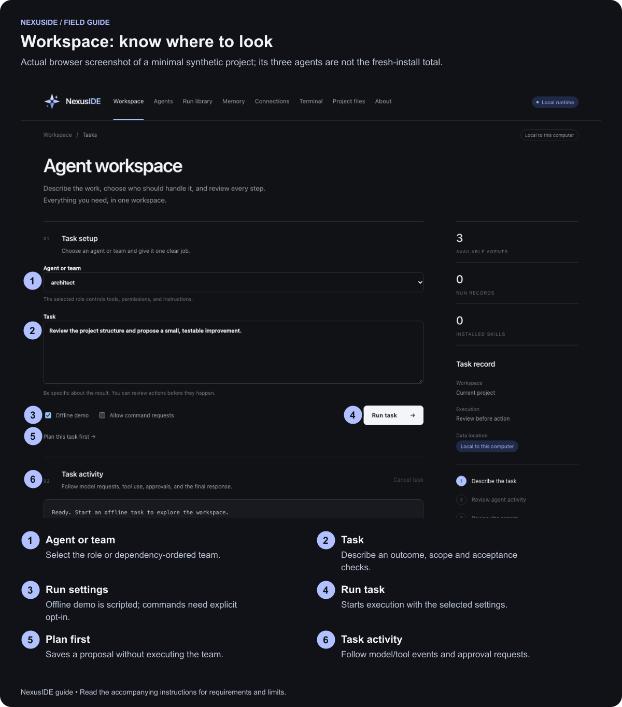

| Area | Use it for |
| --- | --- |
| Workspace | Task setup, a planning proposal, activity, approvals and cancellation. |
| Agents | Role instructions, tool permissions and memory selections. |
| Run library | Saved agent records, transcripts and memory extraction. |
| Memory | Save notes, preview recall, edit/archive notes and review proposals. |
| Connections | Provider/account selection, model routes and advanced MCP settings. |
| Terminal | An explicitly started local shell. |
| Project files | Browse and edit accessible project text files. |
| Code map | Query a separately configured local code index. |
| About | System diagram and bundled visual guide. |

### 2.2 Use a smaller window


*Panels stack vertically. Scroll the top navigation horizontally and scroll below
the task form to reach activity and approvals. This is a narrow browser layout,
not a separate phone app or remote-access service.*

A phone on the same Wi-Fi cannot reach the default loopback server. Resize the
browser on the host computer to reproduce the layout.

### 2.3 Complete the offline walkthrough

1. Select **architect** and enter: “Inspect this project and summarize its structure.”
2. Keep **Offline demo** checked and **Allow command requests** unchecked.
3. Select **Run task →** and watch **Task activity**.
4. Open **Run library** and select the saved run.
5. Confirm you can see the scripted response and the `list_files` tool result.

Or run:

```sh
nexus run architect "Inspect this project and summarize its structure" --demo
nexus status
```

Offline demo uses a scripted provider, makes no AI-model generation request,
actually exercises the permitted file-listing tool, and saves a local run record.
It does not implement the feature described in your prompt or establish model
quality. Start with the default architect rather than an agent with external grants.

After configuring a real model, uncheck **Offline demo** before running a real task.
**Cancel task** stops future work; it does not revert writes already completed.

## 3. Connect a model

### 3.1 Understand the connection steps

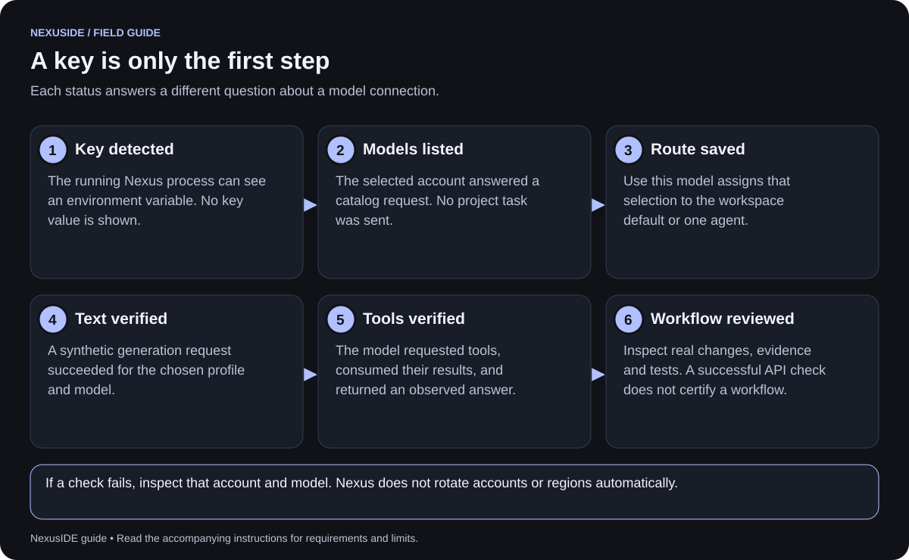

**Detected credentials** tells you which account variables the running process can
see. **Use this model** saves the chosen route. Neither proves generation access.
A model may be listed yet lack tool support, exceed quota or reject a completion.

### 3.2 Export cloud credentials on macOS or Linux

Set only the providers you intend to use. Replace these examples with real keys:

```sh
export OPENAI_API_KEY='your-openai-key'
export ANTHROPIC_API_KEY='your-anthropic-key'
export GEMINI_API_KEY='your-gemini-key'
export XAI_API_KEY='your-xai-key'
export DEEPSEEK_API_KEY='your-deepseek-key'
export MOONSHOT_API_KEY='your-kimi-key'
export ZHIPUAI_API_KEY='your-glm-key'
export DASHSCOPE_API_KEY='your-qwen-key'
nexus serve
```

The example values are intentionally recognized as placeholders. Your exports
must contain real account keys to be shown as available. Nexus does not load
`.env` files or shell startup files automatically.

For the installed macOS app, fully quit Nexus and launch its binary from the
terminal containing your exports:

```sh
/Applications/NexusIDE.app/Contents/MacOS/NexusIDE
```

Finder and `open -a NexusIDE` do not reliably supply that terminal's exports.
Changing exports requires fully quitting and relaunching the runtime from the
configured terminal. **Refresh providers** only checks its existing environment.

### 3.3 Set Windows user environment variables

Persist the desired keys for your Windows user account:

```powershell
[Environment]::SetEnvironmentVariable("OPENAI_API_KEY", "your-openai-key", "User")
[Environment]::SetEnvironmentVariable("ANTHROPIC_API_KEY", "your-anthropic-key", "User")
[Environment]::SetEnvironmentVariable("GEMINI_API_KEY", "your-gemini-key", "User")
[Environment]::SetEnvironmentVariable("XAI_API_KEY", "your-xai-key", "User")
[Environment]::SetEnvironmentVariable("DEEPSEEK_API_KEY", "your-deepseek-key", "User")
[Environment]::SetEnvironmentVariable("MOONSHOT_API_KEY", "your-kimi-key", "User")
[Environment]::SetEnvironmentVariable("ZHIPUAI_API_KEY", "your-glm-key", "User")
[Environment]::SetEnvironmentVariable("DASHSCOPE_API_KEY", "your-qwen-key", "User")
```

Close and reopen PowerShell, then restart Nexus. These commands update future
processes; they do not update the current terminal automatically. To set a key for
only the current PowerShell session instead:

```powershell
$env:GEMINI_API_KEY = "your-gemini-key"
nexus serve
```

User environment variables are not an encrypted secret store. Avoid placing keys
in project files, screenshots or committed configuration.

### 3.4 Select provider, account, model and route

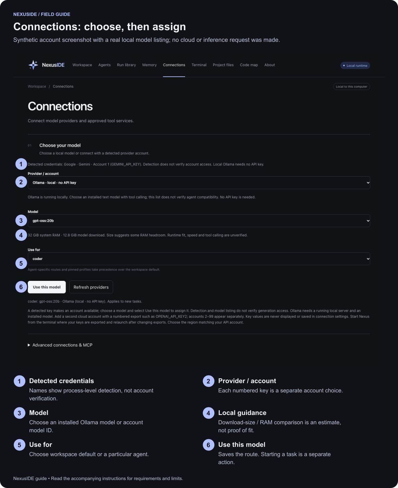

1. Open **Connections** and read **Detected credentials**.
2. Choose **Provider / account**. Missing keys and placeholder values are labeled.
3. Select **Model** from that account's catalog. If cloud catalog loading fails,
   use the manual model-ID option when offered.
4. Choose **Use for → Workspace default** or a specific agent.
5. Select **Use this model** and inspect the saved selection summary.
6. Return to Workspace, choose that agent, turn demo off and start a small task.

A catalog request sends authentication to the selected provider, not project
content. Actual generation sends the task context required by the run. The key
value is never displayed or saved by the picker; the variable name is saved.

| Preset | Variable | Account/endpoint note |
| --- | --- | --- |
| OpenAI | `OPENAI_API_KEY` | Choose a supported text/tool model. |
| Anthropic / Claude | `ANTHROPIC_API_KEY` | Uses the Anthropic Messages adapter. |
| Google / Gemini | `GEMINI_API_KEY` | Uses the compatible endpoint; catalog access does not prove completion access. |
| xAI / Grok | `XAI_API_KEY` | Compatible Chat Completions. |
| DeepSeek | `DEEPSEEK_API_KEY` | Compatible Chat Completions. |
| Moonshot / Kimi | `MOONSHOT_API_KEY` | Select international or China to match the account. |
| Zhipu / Z.ai / GLM | `ZHIPUAI_API_KEY` | Select BigModel or international endpoint as appropriate. |
| Alibaba / Qwen | `DASHSCOPE_API_KEY` | Select the correct region; some accounts need a custom workspace endpoint. |
| Ollama | None | Fixed local service at `127.0.0.1:11434`. |

The runtime uses non-streaming Chat Completions or Anthropic Messages. Some media,
embedding, Responses-only and streaming-only models cannot run through it. The
picker filters known mismatches; it cannot guarantee every returned model works.
See [provider compatibility](providers.md) for exact endpoint and verification scope.

### 3.5 Use multiple accounts from one provider

Keep the standard variable for **Account 1**; append `2` through `99` for others:

```sh
export OPENAI_API_KEY2='your-second-openai-key'
export ANTHROPIC_API_KEY2='your-second-anthropic-key'
export GEMINI_API_KEY2='your-second-gemini-key'
export XAI_API_KEY2='your-second-xai-key'
export DEEPSEEK_API_KEY2='your-second-deepseek-key'
export MOONSHOT_API_KEY2='your-second-kimi-key'
export ZHIPUAI_API_KEY2='your-second-glm-key'
export DASHSCOPE_API_KEY2='your-second-qwen-key'
```

PowerShell example:

```powershell
[Environment]::SetEnvironmentVariable("OPENAI_API_KEY2", "your-second-openai-key", "User")
```

The same persistent-variable command works for all eight numbered names. Reopen
the terminal and restart Nexus after persisting them.

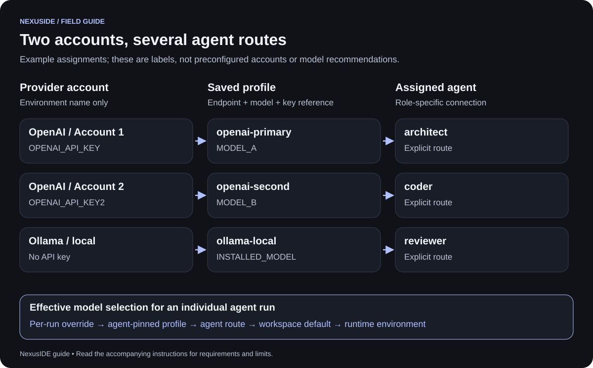

For example, choose OpenAI Account 1 for architect, Account 2 for coder and Ollama
for reviewer. Each selection loads that account's own model catalog and saves its
exact variable reference. Account 2 can work without Account 1 being present.

Suffixes must be unpadded numbers `2`–`99`. `KEY1`, `KEY02` and `KEY_WORK` are not
automatically discovered or forwarded by the macOS host. Removing an export does
not reroute the agent. Restore its key or explicitly choose another account.
Nexus does not rotate keys, switch regions or fail over automatically after errors.

For an individual agent CLI run, effective selection is:

1. Explicit `--provider PROFILE` override.
2. A `provider` pinned in the agent's definition.
3. That agent's configured route.
4. Workspace default route.
5. Runtime environment settings when no profile is selected.

A pinned agent cannot be reassigned by the picker until its definition override
is removed. A team follows the configured routes for its own agents.

### 3.6 Use Ollama locally

Install and start Ollama separately. In a terminal where its CLI is available:

```sh
ollama list
```

If no suitable text/tool model is installed, deliberately download one through
Ollama, for example the model used in this project's local checks:

```sh
ollama pull gpt-oss:20b
```

That example can be a large download and may exceed your hardware's practical
capacity. Choose an appropriately sized tool-capable model for your machine.
If Ollama is not already running, open its app or run `ollama serve` in a separate
terminal; do not start a second server when the app already owns the port.

In Nexus, choose **Ollama → installed model → Use for → Use this model**.
Nexus's picker neither starts Ollama nor downloads models. It excludes known
embedding and explicit remote/cloud tags from its local text-model list.

```sh
nexus providers local
```

This prints the local model list, system RAM, logical CPU count and cautious
RAM/download-size guidance. The same concise advisory appears in Connections.
Download size is not runtime memory: context cache and other apps need space.
GPU fit, speed and tool support remain unverified by that advisory. See
[local-model guidance](local-model-fit.md).

A text model and an embedding model have different jobs. To add semantic memory
later, configure an embedding model separately in [section 9.4](#94-enable-local-semantic-search).

### 3.7 Configure profiles manually

Use **Advanced connections & MCP** for custom endpoints or carefully reviewed
configuration. Importing a config replaces the configuration object: preserve
existing providers, routes, MCP servers, applications and embeddings.

This is a **fresh-workspace example**, with placeholder model IDs:

```json
{
  "version": 1,
  "providers": {
    "cloud-primary": {
      "kind": "compatible",
      "model": "YOUR_OPENAI_MODEL_ID",
      "baseUrl": "https://api.openai.com/v1",
      "keyEnv": "OPENAI_API_KEY",
      "tokenLimitField": "max_completion_tokens",
      "maxOutputTokens": 4096
    },
    "cloud-second": {
      "kind": "compatible",
      "model": "YOUR_OPENAI_MODEL_ID",
      "baseUrl": "https://api.openai.com/v1",
      "keyEnv": "OPENAI_API_KEY2",
      "tokenLimitField": "max_completion_tokens",
      "maxOutputTokens": 4096
    },
    "local": {
      "kind": "compatible",
      "model": "YOUR_INSTALLED_TOOL_CAPABLE_MODEL",
      "baseUrl": "http://127.0.0.1:11434/v1"
    }
  },
  "routes": {
    "default": "local",
    "architect": "cloud-primary",
    "coder": "cloud-second"
  },
  "limits": { "maxSteps": 20, "maxContextChars": 160000 },
  "mcp": {}
}
```

Save your reviewed file, then:

```sh
nexus config import /absolute/path/connections.json
nexus config show
```

This changes routing but does not verify access or make a generation request.
For a one-off agent override:

```sh
nexus run architect "Inspect the parser architecture" --provider cloud-primary
```

Without saved profiles, direct environment configuration is also supported:

```sh
export NEXUS_PROVIDER=anthropic
export NEXUS_MODEL='YOUR_CLAUDE_MODEL_ID'
export ANTHROPIC_API_KEY='your-anthropic-key'
nexus run architect "Inspect this project's structure"
```

Generic compatible endpoints use `NEXUS_PROVIDER=compatible`, `NEXUS_MODEL`,
`NEXUS_API_KEY` and optionally `NEXUS_BASE_URL`. Saved profile routes take precedence
unless explicitly overridden. Environment API-key presence alone does not choose
a cloud route for you.

### 3.8 Verify a chosen connection

```sh
nexus doctor
nexus providers
nexus providers check PROFILE_NAME
```

`doctor` makes no model request and starts no external MCP service. `providers`
shows saved compatibility evidence. The explicit `check` can make up to six
synthetic model requests and may incur charges; it does not switch your default
route. Historical evidence is not proof that today's account or model still works.

For selected profiles, configure `timeoutMs`, `maxOutputTokens` and token-rate
metadata when appropriate. Missing provider usage or rates remains unknown; an
output cap is not a reliable total dollar budget.

## 4. Run an agent

### 4.1 Choose the smallest useful role

```sh
nexus agents
nexus inspect architect
nexus run architect "Explain the parser's modules and cite relevant files"
```

Start read-only. Ask for a concrete outcome, target paths, constraints and success
checks. For example:

> Inspect `src/parser.js` and its tests. Identify one reproducible correctness bug.
> Cite the relevant lines, propose the smallest fix, and wait for approval before editing.

The default library contains 28 definitions. Names such as architect, coder,
reviewer, tester, ui-reviewer and security-reviewer serve different tasks. Read the
actual definition: its name alone does not establish which tools it receives.

### 4.2 Customize a role


1. Open **Agents** and choose an agent.
2. Review instructions, permissions, optional skills, provider pin and external grants.
3. Set its memory selection only if it should use memory.
4. Select **Save agent**.

Definitions live in `.nexus/agents/`. To add a new native role, save this as
`audit-helper.json` and import it:

```json
{
  "version": 1,
  "name": "audit-helper",
  "instructions": "Read relevant source. Report concrete correctness findings with file references. Distinguish observations from suggestions. Do not claim tests ran unless results show they did.",
  "permissions": { "read": true, "write": false, "execute": false }
}
```

```sh
nexus install /absolute/path/audit-helper.json
nexus inspect audit-helper
nexus run audit-helper "Review the parser for incorrect boundary handling"
```

Optional fields include `skills`, `provider`, `mcp`, `applications`, `memory` and
`memoryLoadout`. Use the [bundled definitions](../examples/agents/) as references.
A prompt, skill or tool description cannot grant runtime permissions.

### 4.3 Understand approval gates

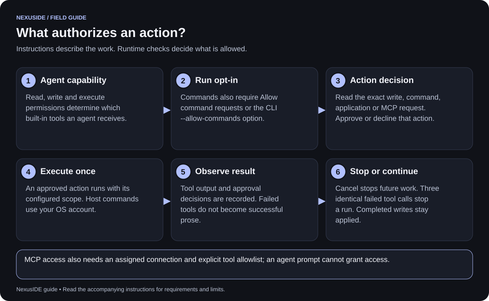

| Action | What enables it |
| --- | --- |
| Read accessible project files | Agent read permission and project path restrictions. |
| Write a project file | Agent write permission and approval for the proposed change. |
| Execute a host command | Agent execute permission, run-level command opt-in, and command approval. |
| Connect an MCP server | Connection assigned to the agent, configured tools, and connection approval. |
| Call an MCP tool | Explicit allowlist plus approval for that call. |
| Run an external application | Application membership/configuration, execute permission, run opt-in and approval. |
| Save an agent-proposed memory | Memory enabled and explicit save approval. |

In the dashboard, read the exact request before choosing **Approve** or **Decline**.
CLI approvals require an interactive terminal. Declining an action does not grant
a later request automatically.

To allow the configured tester to request commands:

```sh
nexus run tester "Run the focused parser tests and report the exact results" --allow-commands
```

Host commands run under your account. A Git worktree isolates files, not OS
privileges. Docker command mode is optional and requires a separately installed
Docker setup plus a pinned local image; see [sandbox boundaries](../SECURITY.md).

### 4.4 Control failures and cost

The default run limit is 20 model steps and 160,000 context characters, configurable
within runtime bounds. Characters are not tokens. A single step can request
multiple tools; smaller tasks and narrow context are still useful.

After three failed calls with the same tool and equivalent inputs, Nexus stops
before another tool/model request. Successful execution of that same call resets
its counter. Changing inputs permits a new approach within the run limits.
Provider failures already stop without automatic retries or account rotation.

Inspect the failure before continuing. Repeating an unchanged prompt against a
broken tool wastes requests. See [checkpoint and retry rules](workflow-checkpoints.md).

## 5. Run teams and review isolated changes

### 5.1 Run the default development team

```sh
nexus team run development "Fix the parser's handling of empty input"
nexus team status
```

The default development team plans, implements, then runs code/security review
stages. Dependencies determine execution order. Read-only stages can overlap;
write-capable stages in a shared workspace serialize. Teams pass bounded reports,
not unlimited conversation histories.


*Ask for a plan before a substantial edit. A saved plan remains a proposal until
you deliberately run its team.*

### 5.2 Plan first in the dashboard

1. Describe the outcome in **Workspace**.
2. Select **Plan this task first →**.
3. Inspect the proposed steps, agent names, tasks, dependencies and approval flags.
4. Choose the resulting `plan-…` team under **Agent or team**.
5. Turn demo off for real work and select **Run task**.

CLI equivalent:

```sh
nexus plan "Improve error handling without changing the public parser API"
```

This stores a plan and validated team; it does not execute the plan.

### 5.3 Define a small team yourself

Save as `parser-fix.team.json`:

```json
{
  "version": 1,
  "name": "parser-fix",
  "steps": [
    { "id": "plan", "agent": "architect", "task": "Inspect parser and tests. Propose acceptance checks." },
    { "id": "build", "agent": "coder", "task": "Implement the approved scope.", "dependsOn": ["plan"], "approval": true },
    { "id": "review", "agent": "reviewer", "task": "Inspect current changes and identify defects.", "dependsOn": ["build"] }
  ]
}
```

```sh
nexus team install /absolute/path/parser-fix.team.json
nexus team run parser-fix "Handle empty input while preserving existing valid behavior"
```

Workflows require version 1, unique IDs, existing agent names and an acyclic
1–30-step dependency graph. The step approval flag gates the stage; it does not
replace file or command approvals.

### 5.4 Add independent review

```sh
nexus extras install review
```

Assign different models to architect/plan-critic and coder/implementation-inspector
in **Connections**. Then select the `independent-review` team with demo off:

```sh
nexus team run independent-review "Implement the scoped parser correction"
```

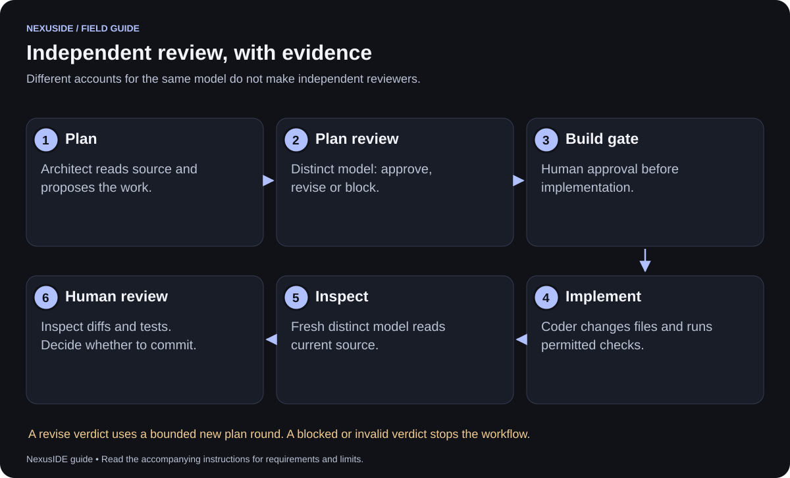

The example allows two plan rounds, an aggregate request budget and a build gate.
Review verdicts must use structured JSON and quote the plan or files actually read
in that review run. Final inspection must cite current source. Invalid evidence,
blocked verdicts, exhausted budgets and failed requests stop the team.

Different accounts for the same model do not count as distinct reviewers. Model
identity checks use configured identifiers, not provider-attested provenance.
This team uses a shared workspace, cannot run in offline demo or per-stage
`--isolated` mode, and does not support checkpoint resume. Final inspection does
not start an automatic repair loop. See [independent review](independent-review.md).

### 5.5 Continue a safe checkpoint

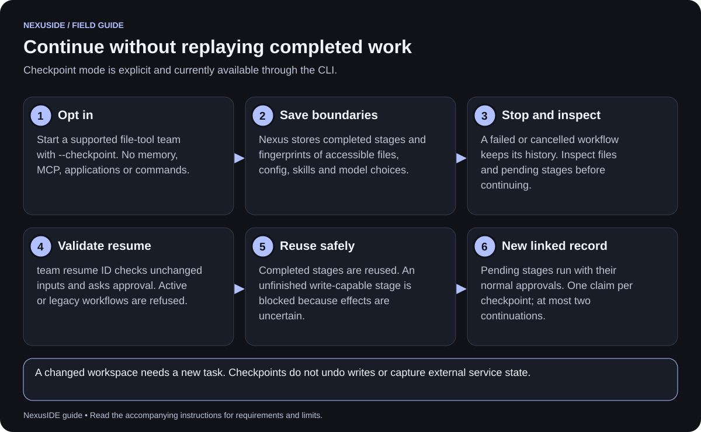

For supported file-tool teams:

```sh
nexus team run parser-fix "Apply the scoped parser correction" --checkpoint
nexus team status WORKFLOW_ID
nexus team resume WORKFLOW_ID
```

Resume asks approval, checks project/config/agent/skill/model fingerprints and
creates a new linked record. Completed stages are reused. Pending stages still
need their usual approvals. A checkpoint can be claimed once; a chain permits at
most two continuations.

Current limits matter:

- Shared-workspace file-tool teams only; no commands, applications, MCP or agent memory.
- Unfinished write-capable stages cannot replay because their side effects may be uncertain.
- Changed source or configuration requires a new task.
- Active, legacy, independent-review and isolated workflows cannot resume this way.
- Capture is bounded to 5,000 directory entries, depth 20, 8 MB/file and 50 MB total.

A crashed workflow must first be confirmed orphaned using the recovery commands
in [section 15](#15-back-up-restore-and-upgrade). Checkpoints store fingerprints,
not full copies of files or external state. Full rules: [workflow checkpoints](workflow-checkpoints.md).

### 5.6 Use Git worktrees deliberately

Worktrees require an existing Git repository with a committed starting revision:

```sh
nexus worktree create parser-task
nexus run coder "Apply the scoped parser change" --worktree parser-task
nexus worktree list
nexus worktree diff parser-task
```

For per-stage worktrees, use `nexus team run ... --isolated`. Stages exchange
reports; files from one stage are **not automatically merged into another**.
Choose shared workspace execution when the next stage must inspect the previous
stage's files, particularly for independent review.

Inspect changes and tests, then make your own commit in the task worktree. From
the original project, request the reviewed merge:

```sh
nexus worktree merge parser-task
```

Nexus shows revisions, paths and diff for approval, rechecks them, and permits only
a safe fast-forward. Dirty/divergent workspaces, protected paths and unsupported
file/filter conditions are refused. The command does not commit, push or delete
worktrees for you.

## 6. Import a third-party agent or skill

### 6.1 Import a native agent or foreign Markdown instructions

```sh
nexus install /absolute/path/native-agent.json
nexus import /absolute/path/foreign-agent.md
nexus agents
nexus inspect IMPORTED_AGENT_NAME
```

Native JSON must match Nexus's supported schema. Foreign Markdown import preserves
instructions and records compatibility, with execution disabled and read-only
permissions. Vendor-specific hooks, tools and orchestration do not become portable
merely because their instructions were imported. Inspect the resulting definition
and add only the grants you intend to support.

### 6.2 Import a skill directory

A skill package contains `SKILL.md` and may include scripts, references, or other
resources. `SKILL.md` needs YAML frontmatter with a valid `name` and `description`.
Run these commands inside the project that should receive the skill.

**First, scan the downloaded directory without importing it:**

```sh
nexus skills scan /absolute/path/skill-directory
```

This local check reads the package and prints a JSON report. It does not execute
its scripts, contact a model, or install the package. Read the findings and the
actual files before deciding whether to import. Check the source, revision,
license, commands, and destinations that would receive data. The scanner cannot
establish the publisher's identity or determine whether every instruction is safe.

**After reviewing it, import and inspect the saved copy:**

```sh
nexus skills import /absolute/path/skill-directory
nexus skills list
nexus skills inspect SKILL_NAME
nexus skills audit SKILL_NAME
```

Replace `SKILL_NAME` with the `name` from the package's frontmatter. Import stores
the instructions and resources in this project's `.nexus`, records a digest, and
runs the same static scan. **Findings do not automatically block import.** Import
does not execute scripts or install their dependencies; you still decide whether
the package is suitable.

**Assign only the reviewed skill to an agent:** open **Agents**, select the role,
add the imported name to its JSON `skills` array, and select **Save agent**. For
example, if its name is `writing-review`, use `"skills": ["writing-review"]`.
Keep any other assigned skills you intend to retain. A skill's `allowed-tools`
or hook text does not grant runtime permissions. Commands and external tools
still require Nexus's applicable grants and approvals.

#### What the native scanner checks

Nexus uses its own local scanner, `nexus-static-v2`. It searches readable UTF-8
files for seven groups of indicators:

| Indicator | Example of what it flags |
| --- | --- |
| Download and execute | A `curl` or `wget` download piped directly into a shell |
| Embedded credentials | Text shaped like selected API keys or access tokens |
| Instruction overrides | Requests to ignore previous, system, or developer instructions |
| Destructive commands | Selected deletion, disk-formatting, or unsafe permission patterns |
| Credential access | References to common key files, credential stores, or `.env` files |
| Network transfer | Selected commands or API calls capable of sending data |
| Dynamic code | Selected uses of `eval` or JavaScript's `Function` constructor |

A finding is a reason to inspect the surrounding code. A credential-file reference
in documentation, for example, can be legitimate. Conversely, an unfamiliar,
obfuscated, or differently written harmful command may not match a rule. The
scanner does not execute the code, trace all data flows, check dependency
vulnerabilities, or provide an LLM security review.

#### How to read scan results

The CLI report includes `engine`, `verdict`, severity `counts`, and `findings`
with a file, line number, rule, and title. It also reports `coverage` so you can
see which resources were inspected, skipped, or left unvisited.

| CLI verdict | Meaning and next action |
| --- | --- |
| `high-risk-indicators` | At least one high-severity pattern matched. Inspect every finding before deciding whether to use the package. |
| `review-recommended` | Medium-severity patterns matched. Check whether each behavior is intended and appropriately restricted. |
| `no-known-indicators` | No selected pattern matched and scan coverage is complete. This is not a safety certificate. |
| `incomplete-review` | No matched indicator took precedence, but coverage is incomplete. Review the omitted resources separately. |

Check coverage **regardless of verdict**. A high-risk or review-recommended result
can also have skipped files or truncated findings. Binary and non-UTF-8 resources
are skipped. Findings stop at 500; `truncated` and `unvisitedFiles` identify the
remaining coverage limit. Package intake separately refuses symlinks, hard links,
unsupported file types, more than 500 file/directory entries, or over 10 MB of
resource contents. Refusal means the package was not fully scanned or imported.

#### Audit an installed skill in the dashboard

1. Open **Memory** in the browser dashboard or macOS app.
2. Expand **Installed skills** near the bottom of the page.
3. Select **Audit skill** beside the package you want to inspect.
4. Read the integrity result, inspected-file count, high/medium indicator counts,
   skipped-resource notice, and any finding-limit warning. Expand **Review
   indicators** when findings are present to see their file and line references.

The button checks the **saved imported copy**, not the original download folder.
It does not import a new directory, update the skill, execute resources, or change
agent permissions. To review a package before import, use `nexus skills scan`.

The equivalent terminal command is `nexus skills audit SKILL_NAME`; omit the name
to audit all installed skills. An audit returns separate integrity and scan
results. `matches-record` means the saved resources match their recorded digest
and instructions. `unverified` means that consistency could not be established;
read the error before using the skill. Neither result authenticates its publisher.
Someone who can rewrite local state can also replace its digest.

The runtime checks stored skill consistency when loading an assigned skill and
refuses mismatched resources or cached instructions. This is an integrity check,
not a fresh comprehensive security scan. Restore the reviewed original record or
review and import a replacement under a new skill name if the stored copy fails.
Scan findings are reported as data; a successful CLI exit alone is not a security
approval or a substitute for reading the report.

#### Is this NVIDIA SkillSpector?

NVIDIA's [SkillSpector](https://github.com/NVIDIA/skillspector) is listed as an
optional reference in Nexus's integration catalog. **SkillSpector is not installed,
bundled, or called by these commands or the Audit skill button.** Nexus's native
scanner is a narrower static pattern checker, not an equivalent implementation
of SkillSpector's broader analysis pipeline. For the integration status and scope,
see [the integration notes](integrations.md).

Personal imports stored in `.nexus` are not automatically included in a fresh
installation or public source download. An optional role present in the developer's
workspace is not proof that every user receives that private configuration.

## 7. Use research and hobby workflows

### 7.1 Know what is bundled and what is separate

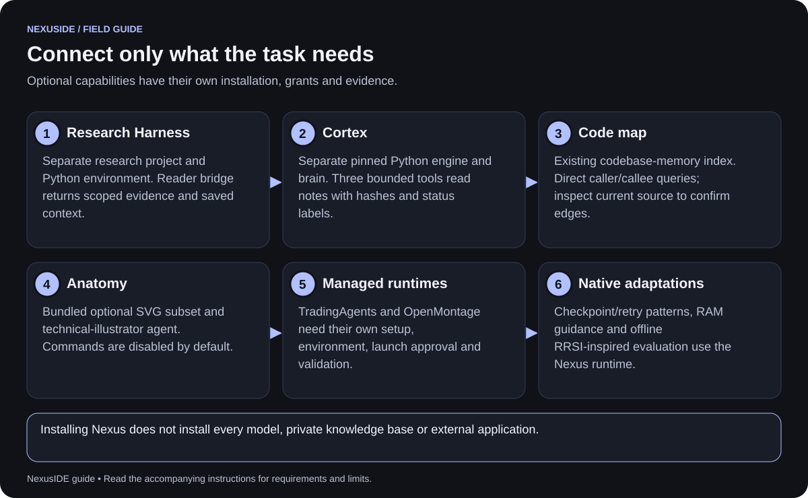

| Capability | Start here | Separate prerequisite |
| --- | --- | --- |
| Research team | `nexus packs install`; select `research`. | Supplied papers/data or intentionally configured research tools. |
| Research Harness reader | Configure the reader example and `harness-context-reader`. | Harness installation, its Python environment and an intended research project. |
| Cortex notes | `nexus extras install cortex --engine … --brain …`. | Python, reviewed engine and private brain; currently POSIX support required. |
| Independent review | `nexus extras install review`. | Distinct available author/reviewer models. |
| Technical SVG illustrations | `nexus extras install anatomy`. | Bundled optional subset; commands start disabled. |
| Code map | Configure local backend, then open Code map. | Reviewed codebase-memory-mcp executable and a source-scoped index. |
| TradingAgents | Managed install/configure commands below. | Its runtime dependencies, model/data setup and approved launches. |
| OpenMontage | Managed install/configure commands below. | Its runtime, media/tools and optional generation-provider setup. |

### 7.2 Research Harness reader


1. Review [reader configuration](../integrations/research-harness.example.json)
   and [agent definition](../examples/harness-context-reader.json).
2. Set absolute paths for the Harness Python environment, Nexus's
   `integrations/research-harness-reader.py`, and the intended research project.
3. Merge the MCP entry into your existing project config, preserving other entries.
4. Install the example agent using its absolute path, then select `harness-context-reader`.
5. Approve the connection and intended read calls.
6. Check returned source/version/hash provenance before using a claim.

The reader supports the reviewed Harness 0.16.0 interface for saved paper Q&A,
study comparisons, causal worksheets, prompt experiments and original-document
citation checks. Discovery uses `list_workbench_artifacts`; paged reads retain
`expected_version` and `expected_content_hash`. Refresh stale pins instead of
removing them. Citation offsets refer to extracted text, not PDF page numbers.

Example task:

> List the saved workbench answers for this research project. Read the selected
> answer with its version/hash pins, check its cited source spans, and separate
> supported claims from limitations and historical context.

Nexus's reader cannot admit evidence, approve lessons, execute arbitrary research
code or release a publication. Open original PDFs and perform operator actions in
Research Harness itself. Its accounts and private project data remain separate
from Nexus's Connections settings. See [integration details](integrations.md).

### 7.3 Cortex knowledge reader

```sh
nexus extras install cortex \
  --engine /absolute/path/cortex/cortex.py \
  --brain /absolute/path/cortex/brain
nexus inspect cortex-reader
nexus run cortex-reader "Find reviewed notes about our parser design and summarize their provenance"
```

Setup pins engine bytes and keeps the private brain outside the app. The three
tools find notes, read bounded content and assemble context. Source hashes and
review labels are returned. The reader does not write notes, compile the brain or
mark an agent's text verified. The current adapter requires macOS/Linux POSIX
filesystem support. See [Cortex setup](cortex.md).

### 7.4 Anatomy technical illustrations

```sh
nexus extras install anatomy
nexus run technical-illustrator "Draft an SVG explaining the parser's data flow"
```

The optional agent uses a small licensed SVG toolkit. Commands are disabled by
default; file writes need approval. Ask for an editable SVG, a descriptive title,
accessible labels and a short explanation of what the diagram assumes. This is a
focused illustration resource, not a full externally installed Anatomy platform.
See [Anatomy resources](anatomy.md).

### 7.5 TradingAgents and OpenMontage

```sh
nexus integration status
nexus integration install tradingagents
nexus integration configure tradingagents
nexus integration install openmontage
nexus integration configure openmontage
```

Install explicitly runs reviewed third-party setup code. Configure shows the
project agent, execute grant and environment-key names to approve. Neither copies
API-key values into configuration. A ready status checks source/executable
readiness; it does not prove every provider-backed workflow succeeds.

```sh
nexus team run trading-research "Compare the supplied paper-trading hypotheses" --allow-commands
nexus team run movie-studio "Plan a two-minute short using supplied assets" --allow-commands
```

The specific agent must also have the configured application grant. Each launch
still requests approval. Nexus does not place brokerage orders. Media generation
or rendering depends on the external runtime's setup, assets, license and costs.
Do not treat a planning answer as a completed render or trading result.

Managed lifecycle commands:

```sh
nexus integration upgrade openmontage
nexus integration rollback openmontage
nexus integration recover openmontage
nexus integration unconfigure openmontage
nexus integration uninstall openmontage
```

Upgrade uses the reviewed catalog pin, not arbitrary latest source. Unconfigure
revokes managed project grants. Uninstall disables the runtime while retaining
recoverable files; it does not recursively erase outputs. Recovery checks stopped
owners and does not replay installers. See [integration lifecycle](integration-lifecycle.md).

### 7.6 Native adaptations from reviewed projects

Checkpoint/retry behavior, local-model RAM guidance and the offline harness gate
are Nexus-native features informed by LazyCodex, Odysseus/llmfit and RRSI. Those
projects are not installed as additional coordinators. A general external
Odysseus data connector and autonomous harness evolution are not implemented.
See [the integration catalog](../integrations/catalog.json) for each adoption's scope.

## 8. Configure MCP tools

MCP connects separately configured tools to an agent. Use a narrow allowlist;
an empty tool list exposes no tools. Connections are made when assigned and
approved, rather than when Nexus merely opens the configuration page.

Example structure to **merge into an existing config**:

```json
{
  "mcp": {
    "my-reader": {
      "command": "/absolute/path/to/reviewed-reader",
      "args": ["--project", "/absolute/path/to/approved-data"],
      "tools": ["list_records", "read_record"],
      "envKeys": []
    }
  }
}
```

This fragment is not a complete config and the tool names are illustrative.
Use actual names documented by your chosen server. Add the matching server name
to the agent's `mcp` list, save the full config, then inspect connection and call
requests during a small task.

Streamable HTTP servers use `transport: "http"`, `url`, optional `keyEnv`, and
`tools`. Stdio servers use `command`, `args`, optional `envKeys`, and `tools`.
Use absolute executable paths when Finder's minimal PATH cannot find a tool.

An MCP process or remote endpoint can have broader capabilities than its labels
suggest. Configure its own filesystem/network boundaries too. Only explicitly
named environment variables are forwarded to configured subprocesses. See
[security boundaries](../SECURITY.md) and [integration guidance](integrations.md).

## 9. Save and inspect memory

### 9.1 Choose a layer and scope

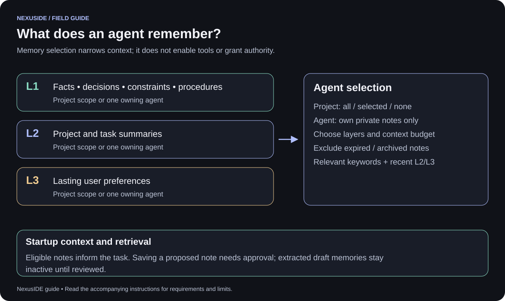

| Layer | Save | Example |
| --- | --- | --- |
| L1 | Facts, decisions, constraints, procedures. | “The public parser API must remain backward-compatible.” |
| L2 | A bounded project or task summary. | “Parser implementation lives in src; focused tests are under test.” |
| L3 | A stable preference actually expressed by the user. | “Show the outcome before technical details.” |

Notes are project-scoped or owned by one agent. An agent can retrieve selected
project notes and its own private notes; another agent's private notes stay
excluded. Archived/expired notes remain inspectable but are excluded from recall.

```sh
nexus memory add "Preserve the public parser API" --layer L1 --category constraint
nexus memory add "Prefer concise reviews" --agent reviewer --layer L3
nexus memory list
nexus memory list --agent reviewer
nexus memory search "parser API" --agent reviewer --mode lexical
```

### 9.2 Preview what an agent can recall


In **Memory**:

1. Save one useful fact, decision, summary or preference with its intended scope.
2. In **Recall preview**, select an agent and enter a task/question.
3. Choose **Keyword search · local** or **Keywords + meaning**.
4. Read the actual mode, warnings and returned sources.
5. Edit inaccurate notes or archive context that no longer applies.

In **Agents**, enable `"memory": true` and choose all, selected or no project
memories, then layers and limits. Selection alone does not enable memory.
Command-click on macOS or Control-click on Windows selects multiple notes.

A `memoryLoadout` example, inside an agent definition:

```json
"memoryLoadout": {
  "project": "selected",
  "ids": ["PROJECT_MEMORY_ID"],
  "layers": ["L1", "L2", "L3"],
  "maxItems": 8,
  "maxChars": 12000
}
```

Defaults allow up to eight items and 12,000 serialized characters. Startup context
combines relevant local keyword matches with up to two recent eligible L2/L3 notes.
Memory is untrusted context; it cannot grant permission or certify a fact.

### 9.3 Update or archive with revision checks

```sh
nexus memory history MEMORY_ID
```

Save this as `patch.json`, replacing `expectedRevision` with the current revision:

```json
{
  "expectedRevision": 1,
  "text": "Preserve valid parser behavior and document error-case changes",
  "status": "active",
  "expiresAt": null
}
```

```sh
nexus memory update MEMORY_ID /absolute/path/patch.json
```

A stale revision fails instead of replacing a concurrent edit. To retain a note
without retrieving it, use a patch with `"status": "archived"`. `memory forget ID`
permanently deletes the note and its governed history/vectors; source runs,
legacy copies, drafts and backups can still contain the text.

### 9.4 Enable local semantic search

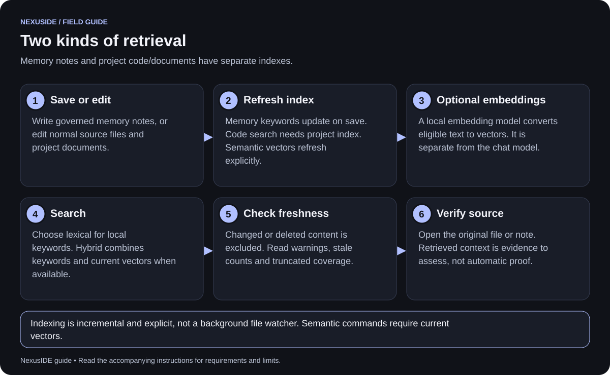

Install an embedding model separately from the chat model:

```sh
ollama pull nomic-embed-text
```

Add this field to the **existing** project config, preserving other settings:

```json
"embeddings": {
  "model": "nomic-embed-text",
  "url": "http://127.0.0.1:11434/api/embed"
}
```

Then:

```sh
nexus memory index
nexus memory semantic "public API constraints" --agent reviewer
nexus project index
nexus project semantic "where is empty parser input handled?"
```

| Mode | Behavior |
| --- | --- |
| `lexical` | Local keyword retrieval; no embedding request. |
| `hybrid` | Combines keyword and current semantic results when available; reports keyword fallback and warnings otherwise. |
| `semantic` | Requires configured embeddings and a compatible current index; does not silently become lexical. |

Indexing sends eligible text to the configured **local** embedding service.
Updates reuse unchanged vectors. Refresh after edits or model changes; use
`--force` when model contents change behind the same model name. Indexing is
explicit, not a background watcher. Read `truncated`, stale counts and warnings.

### 9.5 Extract memories from a completed run

In **Run library**, select a completed record and choose **Extract memories**.
Review the provider, model and transmission request, then review candidates in
**Memory → Proposed memories**. The current model route may be a cloud provider.

CLI alternatives:

```sh
nexus memory distill RUN_ID --demo
nexus memory distill RUN_ID --provider PROFILE_NAME
nexus memory drafts
nexus memory review DRAFT_ID CANDIDATE_ID approve --revision 1
```

Use `reject` for an unwanted candidate. Each decision advances the draft revision;
use the current revision from the returned record for the next decision.

A draft is not recalled until individually approved. Compare its quoted evidence
with the source conversation. L3 preferences require evidence from an original
user message. Distillation does not turn the model's speculation into a user
preference, verified research result or executable skill. See [memory details](memory.md).

## 10. Troubleshooting and security

### 10.1 Start with observable status

```sh
nexus doctor
nexus status
nexus team status
nexus recover activity
nexus recover
```

`doctor` reports configuration and historical verification separately. It does not
treat a past receipt as a fresh test. Keep troubleshooting reports free of real
keys and session URLs.

| Symptom | Likely cause | What to do |
| --- | --- | --- |
| Key missing after export | Nexus was launched earlier or from Finder. | Fully quit and relaunch from the configured terminal. |
| Key shown as example | A placeholder value is still set. | Replace it with the real key and relaunch. |
| Account 2 absent | Its variable does not exist in the runtime, or suffix is invalid. | Use exact `API_KEY2` naming; avoid `KEY02`; restart Nexus. |
| Model listed but requests fail | Quota, access, endpoint/region or adapter incompatibility. | Inspect the saved profile; run one bounded explicit compatibility check. |
| Wrong model runs | An agent pin or role route overrides the default. | Inspect the effective selection summary and agent definition. |
| Ollama unavailable | Service stopped, wrong port or unreadable local response. | Open Ollama or start one server, check `ollama list`, then refresh. |
| Local model absent | Not installed, or excluded embedding/cloud tag. | Install an intended local text model and refresh. |
| Offline result is simplistic | Offline demo is scripted. | Configure a model and turn demo off for real work. |
| Agent cannot run tests | Missing execute permission or run-level opt-in. | Check both permissions and `--allow-commands`; approve the exact command. |
| MCP tool absent | Server not assigned, missing allowlist entry or declined connection. | Inspect agent `mcp` names and the matching config tools. |
| Another writer holds workspace | A run or stale lock owns the lease. | Wait or inspect `recover`; remove only a confirmed stale lock. |
| Checkpoint resume refused | Changed inputs, unsupported grants or uncertain unfinished writes. | Inspect history/files and start a revised task if required. |
| Semantic retrieval unavailable | Missing embeddings or stale/incompatible index. | Check local service, refresh index or deliberately use lexical mode. |
| Empty Code map | Missing/old index, wrong source scope or no matching symbol. | Review backend configuration and refresh the intended index. |
| Native app shows few agents | Old build, different project or incomplete historic initialization. | Check the selected project; run current `init` to add missing defaults. |
| Windows `npm start` shows help | No CLI subcommand was supplied. | Use `npm start -- serve` in the source folder. |
| Browser reports unauthorized | Session URL is absent or stale. | Open the full URL printed by the current server. |

### 10.2 Respect the local ownership boundary

Nexus is a development preview for a local project, not a hardened multi-user
service. Host commands and trusted external tools run with their configured user
privileges. Do not expose the authenticated development server publicly.

Project tools block protected locations such as `.env*`, `.git`, `.nexus` and
credential directories, but that is not an OS sandbox for an approved command.
Use narrow grants and inspect real changes. See [SECURITY.md](../SECURITY.md).

If repeated attempts fail, preserve the error and change the approach rather than
rerunning an unchanged task indefinitely. New live/cloud tests are explicit;
Nexus does not need a constant paid validation sweep to remain open.

## 11. Read run history and usage

```sh
nexus status RUN_ID
nexus team status WORKFLOW_ID
```

Use **Run library** for individual agent transcripts. Workflow records link their
stage run IDs. Inspect:

| Record field | How to interpret it |
| --- | --- |
| `status` | `completed`, `failed`, `cancelled` or recovered `interrupted` describes execution state. |
| `messages` | User/model conversation, tool requests and returned results. |
| `events` | Model activity, tools, approvals, repeated-failure stops and finish events. |
| `usage` | Reported input/output tokens; missing reporting remains explicit. |
| `estimatedCost` | Estimate only when usage and rate metadata are available. Unknown is not free. |
| Workflow `steps` | Dependency-stage outcomes, workspace and linked run IDs. |
| Workflow `review` | Distinct configured model identities, rounds, request budget and evidence-backed verdicts. |
| Checkpoint `parent` | Links a continuation to the stopped record it reused. |

A completed run can still contain declined tools, limited tests or an imperfect
answer. Read the tool evidence and current diff. A reviewer verdict is not a
certification that tests ran or that all defects are absent.

Closing a native window cancels active work and pending approvals. Saved records
remain in the project's `.nexus`; unsaved browser drafts are a different matter.

## 12. Edit files and use the terminal

### 12.1 Project files

Open **Project files**, choose an accessible text file and review its current
content before editing. Save explicitly. If it changed externally since opening,
reload and reconcile it; the editor refuses to silently overwrite the newer file.

Navigation or Code map source opening can require saving or discarding a dirty
draft. Protected paths, links, binaries and oversized text files are restricted.
The file editor is a focused project tool, not a full replacement for your editor.

### 12.2 Embedded terminal

1. Open **Terminal** and choose **Start terminal**.
2. Enter a command, then submit it.
3. Review its output locally; choose **Stop** when finished.

The terminal is an explicitly started shell under your account. Its output is
not automatically sent to a model, and manual terminal commands do not use the
agent approval system. The app stops its terminal with the owned server.
It is not an execution sandbox.

For the terminal-first interface:

```sh
nexus terminal
```

Prefer a normal OS terminal for entering credentials. Avoid printing keys into
retained terminal output or screenshots.

## 13. Connect VS Code and Zed

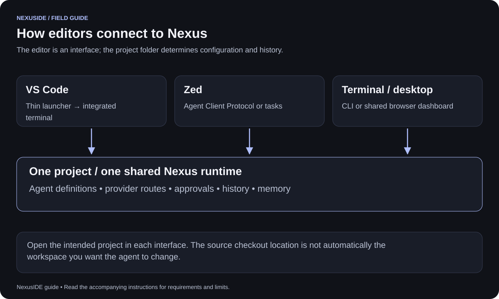

### 13.1 Use any editor's terminal

Open your project in the editor, then in its integrated terminal:

```sh
nexus init
nexus run architect "Map the important modules and suggest the next step"
```

This already uses the same project state as the desktop/dashboard opened on that
folder. You do not need a specialized extension to run CLI agents inside an editor.

### 13.2 VS Code launcher

The repository includes a thin extension at `extensions/vscode`:

1. Open that extension folder in VS Code and press **F5** to start an Extension
   Development Host.
2. In the host's user settings, set the absolute Node and CLI paths:

```json
{
  "nexuside.nodePath": "/absolute/path/to/node",
  "nexuside.cliPath": "/absolute/path/to/NexusIDE/src/cli.js"
}
```

3. Open the intended trusted project folder.
4. Use the Command Palette: **NexusIDE: Initialize Project**, **NexusIDE: Run
   Agent**, or **NexusIDE: Start Dashboard**.
5. Review the CLI task and approvals in the integrated terminal.

Windows paths can use forward slashes in JSON, for example
`C:/Program Files/nodejs/node.exe`. Launch the editor from the environment with
your keys when using inherited exports. The extension is a source/development
launcher, not a claim of a published Marketplace package or inline chat editor.
See [extension instructions](../extensions/vscode/README.md).

### 13.3 Zed Agent Client Protocol

Merge this with your existing Zed settings, using real absolute paths:

```json
{
  "agent_servers": {
    "NexusIDE": {
      "type": "custom",
      "command": "/absolute/path/to/node",
      "args": ["/absolute/path/to/NexusIDE/src/cli.js", "acp"],
      "env": {}
    }
  }
}
```

Open your project, choose the configured NexusIDE external agent in Zed's agent
interface, then select its offered mode/agent. Configure Nexus provider profiles
and intended tool grants in that project first. To explore with scripted responses,
append `--demo` after `acp` in the arguments.

The bridge shares Nexus's runtime, permissions and history. Editor-provided MCP
servers and extra-directory grants are not automatically accepted. Keep approved
external connections in Nexus's own config. Templates:
[ACP settings](../integrations/zed/agent-settings.json) and
[Zed tasks](../integrations/zed/tasks.json).

Task entries can also launch `nexus serve`, `nexus terminal` and demo runs. Merge
them into `.zed/tasks.json`; they require the CLI on the editor's PATH. Preserve
existing task entries. Editor host checks recorded in project audits are bounded
historical tests, not support guarantees for every later editor version.

## 14. Search projects and use Code map

### 14.1 Search code and documents

For a local keyword index without embeddings:

```sh
nexus project index --mode lexical
nexus project search "parser error handling" --mode lexical
```

With local embeddings configured, use `nexus project index` and hybrid/semantic
search as shown in [section 9.4](#94-enable-local-semantic-search).

Project indexing is incremental: unchanged text reuses vectors, changed/new text
is embedded as needed, and deleted sources leave the active index. Search checks
current source hashes. Refresh after editing; excluded stale results can otherwise
look like missing code.

The bounded scan covers at most 10,000 eligible files, 50 MB, 30,000 chunks and
100 KB per file, with protected paths, links, binaries and unsupported files
excluded. Semantic ranking is an exact scan rather than a large-scale approximate
vector service. A truncated result does not establish complete coverage.

### 14.2 Navigate function relationships

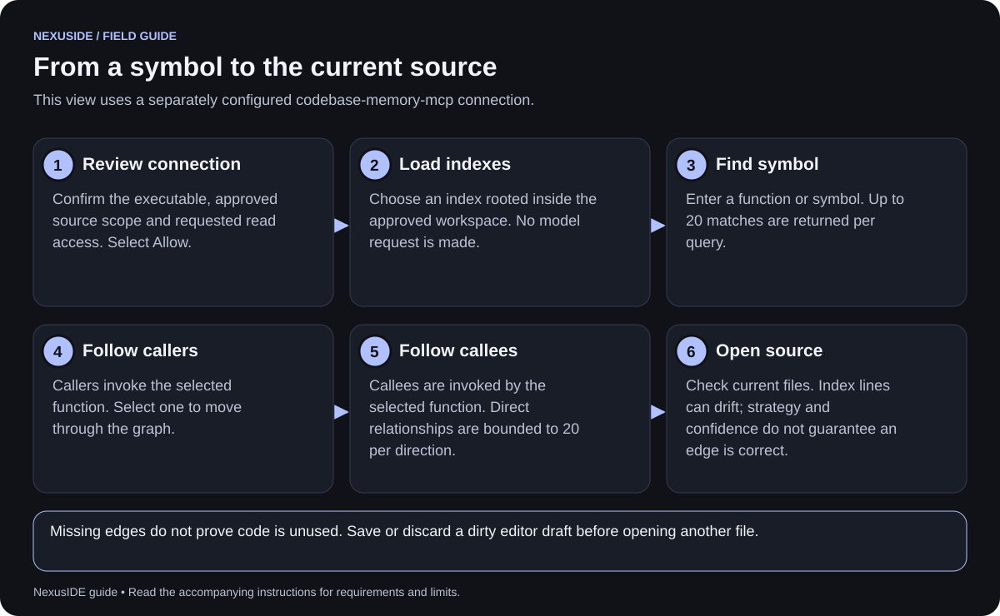

**Code map** uses a separately configured local `codebase-memory-mcp` backend.
It does not create a second graph engine or automatically build every index.
Follow [backend setup](codegraph.md) and [view requirements](code-map.md).

1. Open the tab and review its executable and source scope.
2. Check **Allow** and select **Load indexes**.
3. Select an approved source-scoped index.
4. Enter a function/symbol and choose **Find symbol**.
5. Select a result, then inspect **Callers → Selected function → Callees**.
6. Open the source link and verify the relationship in current code.

Callers invoke the selected function; callees are invoked by it. Select a related
symbol to continue. Direct edges are limited and can be inferred; confidence is
not proof. Index line numbers can drift after edits. Missing edges do not show
that code is unused or untested. The user-operated view makes no model request.

## 15. Back up, restore and upgrade

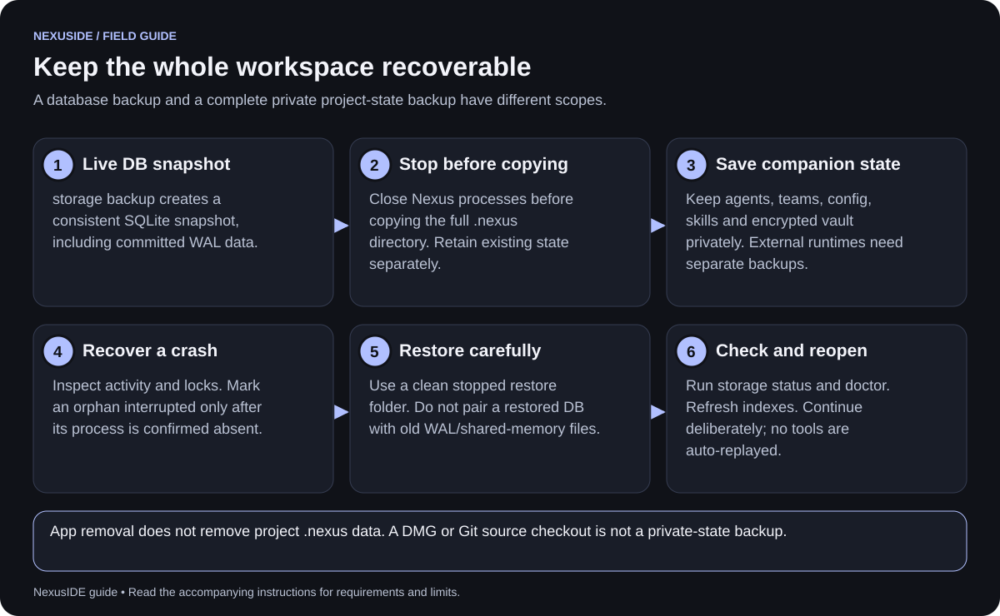

### 15.1 Understand where state lives

```text
your-project/
├── your source and documents
└── .nexus/                       private project state
    ├── storage.sqlite           runs, workflows, notes and indexes
    ├── config/project.json      profiles, routes, MCP and settings
    ├── agents/                  role definitions
    ├── teams/                   workflow definitions
    ├── skills/                  imported skill resources
    ├── vault/                   encrypted secret records, if used
    ├── harness-evaluations/     offline candidate assessment history
    └── other private records    plans, locks, receipts and legacy state
```

On macOS, the app also saves recent-workspace metadata under
`~/Library/Application Support/NexusIDE/.nexus/desktop/` and a last-folder
preference. External runtime folders, private brains, research projects and media
outputs need their own backups. Uninstalling the app does not delete `.nexus`.

### 15.2 Create a consistent database snapshot

```sh
nexus storage status
nexus storage backup /absolute/path/backups/nexus-snapshot.sqlite
```

Backup uses SQLite's online snapshot API and includes committed WAL changes. It
refuses to overwrite an existing destination. The snapshot covers SQLite content,
not configuration, skills, encrypted vault records or external projects.

For a full private-state backup, stop Nexus processes and copy the **whole**
`.nexus` directory to a separate private backup location. Do not copy only a live
`storage.sqlite` and assume all WAL changes are included. Do not remove live
`-wal` or `-shm` files.

### 15.3 Recover after a crash

```sh
nexus recover activity
nexus recover
```

Inspect owners, status and affected workspaces first. If the recorded owner is
confirmed absent:

```sh
nexus recover run RUN_ID
nexus recover workflow WORKFLOW_ID
```

Recovery marks the record interrupted and preserves history; it does not replay
tools. To remove a confirmed stale writer lock, use the unique hexadecimal prefix
shown by `recover` and approve the exact request:

```sh
nexus recover LOCK_KEY_PREFIX
```

Active, unknown, other-host or legacy owners can block recovery intentionally.
Do not delete locks belonging to work you have not verified is stopped.

Continue a normal agent with fresh context when appropriate:

```sh
nexus run architect "Continue the inspection using current files" --resume RUN_ID
```

Agent continuation carries prior human/model prose, not unfinished tool calls.
Workflow checkpoint continuation uses the separate `team resume` rules; it is
not a generic restart for every stopped team.

### 15.4 Restore or upgrade

1. Stop all Nexus processes touching the project.
2. Preserve the current complete `.nexus` separately.
3. Restore a verified snapshot in a clean restore directory with its separately
   saved configuration and other private state.
4. Do not combine the restored database with an old database's WAL/shared-memory files.
5. Run `storage status`, then `doctor`, before continuing.
6. Refresh project/memory indexes against current sources.

Schema upgrades and legacy JSON migration preserve prior source files. Retained
JSON becomes historical after migration; editing it does not edit SQLite state.
Do not point an older incompatible executable at a newer schema. See
[storage migration and recovery](storage.md) before a downgrade.

Updating the installed app replaces executable code, not project history. New
source changes do not modify an already installed DMG/app until it is rebuilt or
replaced. Automatic updates are not implemented.

### 15.5 Optional encrypted vault

Advanced provider profiles can use `keySecret` instead of `keyEnv`. CLI vault
operations use `NEXUS_VAULT_PASSWORD` and `NEXUS_SECRET_VALUE`; the password needs
at least 12 characters. Use an appropriately configured terminal and the
[provider/vault configuration reference](providers.md), then `nexus secret set
SECRET_NAME` and `nexus secret list`.

The environment-based picker does not import vault keys automatically or save
new key values. The macOS host's forwarded-variable allowlist and Finder launch
behavior still apply; do not assume the app can unlock a vault merely because
another terminal once used it. Keep its password recoverable separately from the
backed-up encrypted records.

## 16. Evaluate harness improvements offline

A harness is the instructions, context handling, tools and orchestration around a
model. After deliberately measuring a small change, you can screen its evidence:

```sh
nexus harness evaluate /absolute/path/evidence.json
```

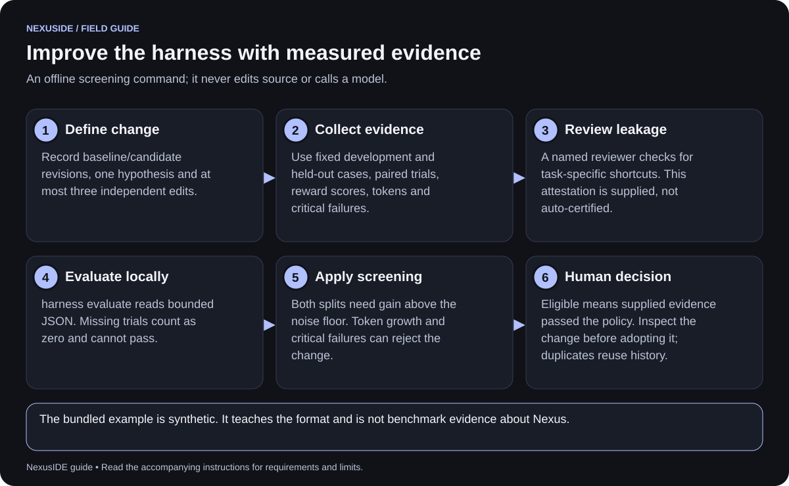

The RRSI-inspired gate checks the supplied evidence rather than running a paid
experiment. It expects fixed development/held-out cases, paired trials, scores,
tokens and critical-failure flags. Missing trials count as zero and cannot pass.
Both splits need improvement beyond the noise floor; token growth, critical
failures and excessive edit count can reject the proposal.

The first submission pins the manifest/baseline for that experiment. Repeating the
same normalized hypothesis returns its prior report. `eligible-for-human-review`
means the supplied numbers passed the policy; it neither verifies those numbers
nor deploys code, changes prompts or approves the candidate.

Use [the synthetic example](../examples/harness-evaluation.json) only in a
disposable practice workspace to learn the format. Its revisions and scores are
made up. See [the full schema and policy](rrsi.md) before using real measurements.

## 17. Worked examples

### 17.1 A focused software correction

**Goal:** fix one error case without changing valid parser behavior.

1. Open the intended project and confirm it is under version control.
2. Run architect read-only: “Inspect empty-input handling; cite files and propose
   acceptance checks.”
3. Review the plan and either run a scoped coder task or a reviewed team.
4. Approve specific file changes. If needed, enable tester command access and
   approve only the relevant test command.
5. Inspect the current diff and observed test output.
6. Run reviewer/security-reviewer as appropriate, or use the optional distinct-model team.
7. Commit reviewed changes yourself; retain the run IDs and unresolved limitations.

```sh
nexus run architect "Inspect empty-input handling and propose a minimal correction"
nexus run coder "Implement only the reviewed empty-input correction"
nexus run tester "Run the relevant parser tests and report exact results" --allow-commands
nexus run reviewer "Review the current parser changes against the acceptance checks"
```

A read-only reviewer cannot independently execute tests. Ask it to verify source
and interpret recorded evidence; do not describe that as a new test run.

### 17.2 Research with source provenance

**Goal:** summarize a supported question from an intentionally configured Harness project.

1. Configure the reader for the intended project, not a copied demo path.
2. Select `harness-context-reader` and ask for bounded source discovery.
3. Approve scoped reads. Keep versions/hashes across pagination.
4. Ask for source-supported claims, contradictions and missing evidence separately.
5. Open original documents and check cited extracted spans.
6. Make admissions, approvals and publication decisions in Research Harness.

Without the optional Harness connection, the research team can work from supplied
project documents and granted tools; do not imply it searched external literature.

### 17.3 Two OpenAI accounts plus a local reviewer

1. Export `OPENAI_API_KEY` and `OPENAI_API_KEY2`; start Ollama with an installed model.
2. Launch Nexus from that environment.
3. Choose OpenAI Account 1 and save a model for architect.
4. Choose OpenAI Account 2 and save the intended model for coder.
5. Choose Ollama and save its installed model for reviewer.
6. Inspect all three summaries before starting the team.

These are deliberate routes, not automatic load balancing or quota rotation.
For independent review, select genuinely different configured author/reviewer
models; merely using two accounts is insufficient.

## 18. Command reference

Run `nexus --help` for the executable's exact current syntax. These commands cover
the common workflows described above:

| Purpose | Command |
| --- | --- |
| Initialize project / packs | `nexus init` · `nexus packs install` |
| Inspect roles | `nexus agents` · `nexus inspect NAME` |
| Run a role | `nexus run NAME "task" [--demo] [--provider PROFILE]` |
| Allow command requests | Add `--allow-commands`; agent execute permission still required. |
| Open interfaces | `nexus serve` · `nexus desktop` · `nexus terminal` |
| Plan / run team | `nexus plan "task"` · `nexus team run NAME "task"` |
| Workflow checkpoints | Add `--checkpoint`; continue with `nexus team resume ID`. |
| Inspect history | `nexus status [ID]` · `nexus team status [ID]` |
| Foreign/native agent import | `nexus import FILE.md` · `nexus install FILE.json` |
| Skills | `nexus skills scan DIR` · `import DIR` · `list` · `inspect NAME` · `audit [NAME]` |
| Configuration | `nexus config show` · `nexus config import FILE.json` |
| Provider evidence / local models | `nexus providers` · `nexus providers local` |
| Explicit model probe | `nexus providers check PROFILE` |
| Optional additions | `nexus extras install review` · `anatomy` · `cortex --engine PATH --brain PATH` |
| Integration catalog/status | `nexus integrations` · `nexus integration status [NAME]` |
| Managed lifecycle | `nexus integration install/configure/upgrade/rollback/recover/unconfigure/uninstall NAME` (choose one action). |
| Memory retrieval | `nexus memory search "query" [--agent NAME] [--mode lexical]` |
| Memory management | `nexus memory list` · `history ID` · `update ID FILE.json` |
| Memory indexing/distillation | `nexus memory index` · `nexus memory distill RUN_ID --demo` |
| Project retrieval | `nexus project index --mode lexical` · `nexus project search "query" --mode lexical` |
| Worktrees | `nexus worktree create/list/diff/merge` with the action's required name. |
| Storage | `nexus storage status` · `nexus storage backup FILE.sqlite` |
| Recovery | `nexus recover` · `nexus recover activity` · `nexus recover run/workflow ID` (choose one kind). |
| Harness evidence | `nexus harness evaluate FILE.json` |
| Zed bridge | `nexus acp [--demo]` |

Slash-separated actions in the table are shorthand for alternatives, not literal
commands. Avoid putting real keys or private session URLs in a command transcript.

## 19. Current capabilities and limits

| Capability | Available here | Practical limit |
| --- | --- | --- |
| Agent runtime | Persistent role definitions, tools, scoped memory and history. | A model's response quality and tool compatibility vary. |
| Cloud accounts | Eight preset key families, numbered accounts 2–99, explicit routes. | No automatic failover, region switching or universal provider validation. |
| Local models | Ollama picker and synthetic tool-use evidence for selected models. | Models/service installed separately; RAM guidance is only an advisory. |
| Desktop | Self-contained macOS app and development DMG. | Ad-hoc signature; no notarization or clean-machine certification. |
| Windows/Linux | Source CLI and local browser dashboard. | Native installers/GUI bundles and broader platform validation remain. |
| Editor access | Terminal launcher, source VS Code extension, Zed ACP/tasks. | Not a full native editor or universal inline assistant integration. |
| Teams | Dependency graph, approvals, reports, optional worktrees and review. | No automatic file merge or arbitrary recursive delegation. |
| Checkpoints | Conservative CLI continuation for supported file-tool teams. | Explicit grants, snapshot and uncertainty restrictions. |
| Retrieval | SQLite keywords and optional local semantic indexes. | Bounded scans; no background file watcher or unlimited project coverage. |
| Optional integrations | Scoped readers, graph queries and managed application profiles. | Separate installations/grants; source checks do not certify external dependencies. |
| Harness gate | Offline policy over supplied measurements. | No self-editing, benchmark execution or independently attested scores. |

Selected local/cloud models, editor-host demos, connectors and install/recovery
paths have historical verification evidence. Gemini generation and a successful
full live distinct-model review workflow remain unverified in the latest audit.
Automated local passes do not certify all optional services or a production release.
See [the latest audit](audit-2026-10-24.md) and [release phases](release-phases.md).

## 20. Glossary and deeper guides

| Term | Meaning in Nexus |
| --- | --- |
| Agent | Persistent instructions plus explicit capabilities, optional skills and context selection. |
| Model | The local or remote inference service answering an agent's requests. |
| Provider profile | Named protocol/endpoint/model and credential reference. |
| Route | Assignment of a profile to a workspace default or agent. |
| Team | Validated dependency-ordered workflow of agent stages. |
| Skill | Imported instructions/resources; it does not grant permissions. |
| MCP | Protocol for explicitly configured external tool servers. |
| Application | Configured external executable with named agent grants. |
| Worktree | Separate Git checkout/branch for file isolation. |
| Memory | Versioned contextual notes with scope, layers and provenance. |
| Index | Search data derived from eligible current notes or files. |
| Checkpoint | Saved workflow boundary and input fingerprints, not a full filesystem backup. |
| Receipt | A record of one check's time, scope and outcome, not a permanent certification. |

| Read more | Guide |
| --- | --- |
| Implementation map | [Architecture](architecture.md) |
| Provider profiles, accounts and evidence | [Providers](providers.md) |
| Memory ownership and distillation | [Memory](memory.md) |
| Storage migration, limits and restore | [SQLite storage](storage.md) |
| Checkpoint behavior and repeated failures | [Workflow checkpoints](workflow-checkpoints.md) |
| Distinct-model review | [Independent review](independent-review.md) |
| Local RAM guidance | [Local-model fit](local-model-fit.md) |
| Function navigation | [Code map](code-map.md) · [backend setup](codegraph.md) |
| Research and optional services | [Integration review](integrations.md) · [catalog](../integrations/catalog.json) |
| Private curated notes | [Cortex](cortex.md) |
| Technical SVG resources | [Anatomy](anatomy.md) |
| Managed runtime changes | [Integration lifecycle](integration-lifecycle.md) |
| Offline candidate measurements | [Harness evaluation](rrsi.md) |
| App installation and release gates | [Desktop distribution](desktop-distribution.md) · [release testing](release-testing.md) |
| Security boundaries | [SECURITY.md](../SECURITY.md) |


*The About page carries the shared system map. In the macOS window, use
**View → Back** (Command-[) after opening a full-size illustration or the Markdown
reference. Keep this guide and its local assets together when sharing it.*
